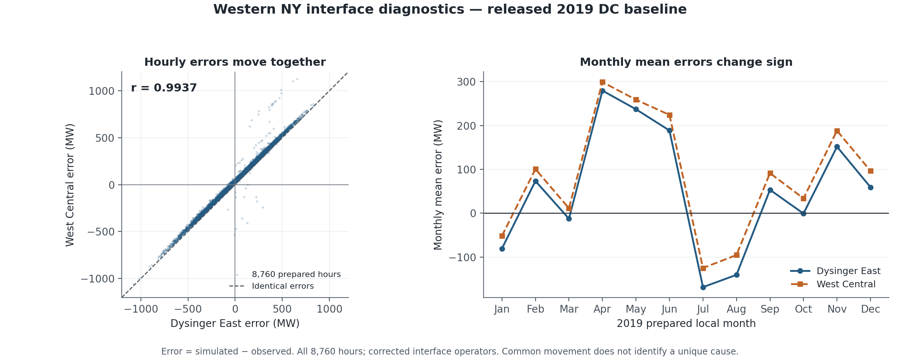

# 2019 raw-load verification and western interface diagnosis

**Verified 2026-10-09.** The released 2019 zonal load inputs reproduce NYISO's
raw integrated-load archives. The remaining Dysinger East and West Central
errors are strongly shared: their hourly errors correlate at **0.9937**, and
their common component contains **99.33% of their combined squared error**.
West Central's larger percentage error is largely a denominator effect, but
both interfaces retain material errors of about **210-218 MW MAE**.

This investigation verifies the load source and localizes the flow discrepancy.
It does not uniquely identify the true hourly Niagara generation, Ontario tie
split, or physical flowgate correction. No source data, model parameters,
baseline dispatch, or previous results were changed. All counterfactuals below
are separately scored diagnostics, not promoted operating models.

## Raw NYISO load verification: complete within the stated preparation method

The source is NYISO's [Integrated Real-Time Actual Load archive, P-58C](https://mis.nyiso.com/public/P-58Clist.htm),
using the twelve `2019MM01palIntegrated_csv.zip` archives. All twelve ZIPs were
downloaded during this investigation; 365 daily member files and all archive
bytes have SHA-256 receipts. An offline rerun then checked reproducibility
against those freshly acquired files. Retrieval time describes the download,
not the original publication version of the historical observations.

The independent Python reconstruction follows the pinned `writeLoad.m`:
use the published local timestamp labels, average samples in each local hour,
and linearly fill missing hourly bins. EST/EDT is retained for a separate
diagnostic but is dropped for the replication, as in the authors' implementation.
The comparison uses exact timestamp-zone keys without shifting, rescaling,
or altering data to improve agreement. A fresh MATLAB export checks the
actual `loadHourly_2019.mat` table rather than assuming it matches the CSV.

| Check | Fresh result |
|---|---:|
| Official monthly ZIPs / daily CSVs | 12 / 365 |
| Raw physical hour-zone records | 96,360 |
| Prepared labels | 8,760 hours x 11 zones |
| Keys matched against released CSV and actual MAT | 96,360 / 96,360 |
| Mismatches above 1e-8 MW | **0** |
| Maximum absolute difference | **2.27e-13 MW** |
| Released CSV versus actual MAT difference | **0** |
| Raw missing/negative load values | **0 / 0** |

The only repeated local timestamp groups are the eleven zones at
**2019-11-03 01:00**, once in EDT and once in EST. Those are distinct physical
hours, not erroneous duplicate telemetry. The authors' preparation averages
them. It also interpolates the eleven absent local zone-hours at
**2019-03-10 02:00**. There are no other interpolated bins or non-DST repeated
local groups. The separate UTC diagnostic has 96,360 distinct physical
hour-zone keys; UTC was not substituted into the replication comparison.

This closes the raw-load-source verification gap. It does **not** validate
the fixed within-zone bus allocations in `npcc_new.csv`. Gross zonal load
must also be distinguished from final net bus PD after wind and other
renewables are subtracted as negative load.

Evidence: [load summary](output/nygrid_2019_diagnostics/load_audit_summary.json),
[all-key comparison](output/nygrid_2019_diagnostics/load_audit_comparison.csv),
[archive receipts](output/nygrid_2019_diagnostics/load_audit_archives.csv),
[daily-member hashes](output/nygrid_2019_diagnostics/load_audit_members.csv),
and [focused DST/interpolation tests](output/nygrid_2019_diagnostics/load_audit_tests.json).

## What the western errors actually look like

The primary baseline is the released **57-bus** model over all 8,760 prepared
2019 hours, using the previously repaired interface map. The five stale
plotting formulas remain a separate implementation problem; their correction
does not explain away the residuals evaluated here. An independent DC solver
reproduces all saved branch flows within 1.21e-11 MW before any decomposition.

| Interface | MAE, MW | RMSE, MW | Bias: simulated minus observed, MW | Mean absolute observed flow, MW | Annual WAPE |
|---|---:|---:|---:|---:|---:|
| Dysinger East | 209.92 | 261.15 | +51.93 | 933.21 | 22.49% |
| West Central | 218.46 | 270.23 | +84.63 | 466.74 | 46.81% |

WAPE is `100 * sum(abs(sim-observed)) / sum(abs(observed))`. West Central's
MAE is only **4.07% higher**, but its denominator is almost exactly half
Dysinger's, making its WAPE **2.08 times larger**. This explains the percentage
disparity, not the underlying MW error. Excluding West Central hours with
absolute observed flow below 100 MW still leaves 220.57 MW MAE and 41.74% WAPE.
Pointwise MAPE is especially unstable near zero: those 1,131 hours contribute
79.69% of its summed percentage errors, but only 12.07% of absolute MW error.

The error is not a single constant bias. Dysinger's monthly bias ranges from
**+279.55 MW in April to -168.50 MW in July**; West Central moves similarly.
On one common 8,756-hour population, zero lag has the lowest MAE and RMSE for
both gates among tested offsets of -2, -1, 0, +1, and +2 hours. A simple
one-hour shift therefore does not resolve these errors. This is a diagnostic
result, not a new claim about interval-beginning/end semantics.
The error also persists at the most common published Dysinger limit: 3,150 MW
appears in 8,130 hours, whose MAE is still 207.28 MW. Thus the discrepancy is
not confined to hours with a different published limit. These limit levels
are not a complete outage or control-state inventory.
[Limit-regime comparison](output/nygrid_2019_diagnostics/western_limit_regimes.csv).



## The governing balance narrows the problem

Inspection of every boundary branch establishes these exact **modeled,
lossless** identities:

\[
F_{WC}-F_{Dys}=P_B^{net},\qquad
F_{Dys}=P_A^{net}+I_{Ontario\rightarrow A}.
\]

Here net injection includes modeled native generation, net demand, and active
shunt consumption. The model has no A-C bypass, no external/DC boundary at B,
and only two Ontario ties into A (54-102 and 54-103). Ontario's other NY
connection is 48-100 in D. The sum of modeled Ontario imports reproduces the
released scheduled total, but its allocation between A and D is a network
result, not observed individual-tie telemetry.

Both identities hold across all hours to less than 2.1e-11 MW. Let the two
interface errors be eD and eW. The common component `(eD+eW)/2` contains
99.33% of the pair's squared error, and their signs agree in 8,356 hours.
The difference `eW-eD` has only **33.71 MW MAE**, compared with each gate's
roughly 210-218 MW MAE. Thus the main residual is a shared western-transfer
problem; a B net-injection discrepancy alone is insufficient to explain it.

This is an **accounting decomposition, not causal attribution**. Under the
model, the shared residual can arise from western generation/net demand,
the Ontario import split, and differences between modeled and actual
measurement boundaries. Observed real-system losses and incomplete flowgate
equivalence also affect interpretation of the smaller B balance difference.
At fixed B net injection, changing reactances cannot change `F_WC-F_Dys`;
it can change the common flow through network routing and import distribution.

Evidence: [topology ledger](output/nygrid_2019_diagnostics/western_topology_edges.csv),
[hourly decomposition](output/nygrid_2019_diagnostics/western_hourly.csv),
[summary](output/nygrid_2019_diagnostics/western_summary.json),
[monthly results](output/nygrid_2019_diagnostics/western_monthly_metrics.csv),
and [lag tests](output/nygrid_2019_diagnostics/western_lag_diagnostics.csv).

## Primary-source findings and matched counterfactuals

**Niagara allocation is materially simplified.** The code sets Niagara to
80% of statewide hourly hydro minus a monthly-constant St. Lawrence output.
It does not enforce its supplied monthly Niagara `rmnGen` series. The modeled
Niagara sum is 1,202,290 nominal MWh below that series for the year, or
137.25 MW on average, with large July-September deficits. This is a discrepancy
between released input representations; EIA/NYISO net/gross, pumping, and
plant-reporting boundaries have not been independently reconciled here.

Actual spatial control is also richer. The [2019 State of the Market, printed page 39](https://www.nyiso.com/documents/20142/2223763/NYISO-2019-SOM-Report-Full-Report-5-19-2020-final.pdf/bbe0a779-a2a8-4bf6-37bc-6a748b2d148e)
documents Niagara's 115/230-kV injection distribution and western congestion
management using import/generation restrictions and phase-angle regulators.
The release puts reconstructed Niagara at one 230-kV bus and has no hourly
PAR-setpoint input. These are supported candidate mechanisms, not measured
shares of the annual error.

**A shared thermal profile is replicated.** Jamestown 5, 6, and 7 all map to
RGGI Facility 2682 / Unit 20, and have identical full-year generation and
heat-input vectors. The source join retains three separate NYISO records
without an inverse one-to-many allocation rule. Counting the common profile
once would remove a conditional 29.998 MW average from A. Whether that is the
correct physical interpretation still requires the original combined-unit
reporting context. A source-consistent statewide reconciliation must put
removed generation elsewhere; it cannot simply delete the state total.

Four specified alternatives were tested without fitting interface observations:

| Diagnostic scenario | Dysinger MAE, MW | West Central MAE, MW |
|---|---:|---:|
| Released 57-bus baseline | **209.92** | **218.46** |
| Match supplied monthly Niagara energy while preserving hourly state hydro and St. Lawrence schedule | 239.76 | 254.88 |
| Restore original NPCC B load shares, preserving B gross demand | 209.97 | 218.54 |
| Conditional shared Jamestown profile counted once; balance removed A generation at J | 214.40 | 219.90 |
| Derived full-140 baseline for the topology test | **209.92** | **218.46** |
| Restore three raw remote ties at fixed full-140 injections | 363.80 | 334.54 |

Every specified alternative worsens annual MAE. The hydro variant helps some
months, including July, but worsens others and annual agreement. The conditional
Jamestown change improves mean bias while worsening MAE: bias reduction is
not the same as better hourly prediction. Restoring remote ties changes each
external region's direct NY interchange; its inputs had originally been
scaled assuming those ties were absent. That test does not rule out a jointly
consistent reconstruction of external dispatch and topology.

All scenarios preserve hourly system net injection and solve DC nodal balance
within 1e-7 MW. They do not enforce plant or thermal capability bounds and do
not establish corrected dispatch. Their lack of improvement does not validate
the original source assumptions. See [counterfactual metrics](output/nygrid_2019_diagnostics/counterfactual_metrics.csv),
[monthly results](output/nygrid_2019_diagnostics/counterfactual_monthly_metrics.csv),
[hydro reconciliation](output/nygrid_2019_diagnostics/hydro_monthly_balance.csv),
and [scenario definitions and limits](output/nygrid_2019_diagnostics/counterfactual_summary.json).

## Measurement definitions are another unresolved boundary

The model's corrected gates each sum four coarse branches. The [Summer 2019
NYISO operating appendix, printed page 72](https://www.nyiso.com/documents/20142/3691300/Summer2019-Operating-Study-Appendices-OC-Approved.pdf/7923fe3b-579b-a48d-bda8-8063b309dc08)
lists ten physical Dysinger members, including A-C paths and mixed metering
ends. A coarse equivalent need not have ten branches, but a physical-to-model
measurement crosswalk must establish equivalent coverage. Matching the model's
own zone labels does not by itself establish that crosswalk.

The exact 2019 West Central meter configuration was not located in the
inspected contemporaneous operating appendix. The dated [November 2014 NYISO
DE/WC study](https://www.nyiso.com/documents/20142/1394656/DE_WC_Stability_Limit_Report_final-3.pdf/b461b192-f51d-7bf7-340e-d424b60c84fa)
documents both interfaces' shared transfer behavior through the Genesee load
pocket. It also replaces West Central stability limits with 9999 because those
constraints are redefined in terms of Dysinger East. Thus the release's 9999
denominator is not a physical equipment rating; a small limit-normalized
percentage can coexist with substantial actual-flow error. The 2014 and
undated planning member lists are retained as context, not certified 2019
meter membership.

[Source evidence](output/nygrid_2019_diagnostics/western_source_evidence.json)
contains the official document receipts, page references, source code traces,
unit identities, and unresolved qualifications.

## Decision and reproduction

The raw-load inputs require no correction. The numerical diagnosis excludes
source-load ingestion and a simple hourly offset as explanations, and shows
why these gates share a large residual while West Central looks worse in
percentage terms. The specific allocation/control/measurement cause remains
underdetermined by the available observations.

Prioritize the official physical-to-model flowgate mapping, actual hourly
Niagara injection groups and Ontario tie flows/PAR settings, and the shared
RGGI unit's reporting semantics. Those sources are needed before promoting a
physical correction. Do not tune reactances merely to absorb these unresolved
input or measurement discrepancies.

From the repository root:

```powershell
python scripts/nygrid_2019_diagnostics/restore_load_archives.py
python scripts/nygrid_2019_diagnostics/test_audit_raw_load.py
python scripts/nygrid_2019_diagnostics/audit_raw_load.py --offline
python scripts/nygrid_2019_diagnostics/western_flow_diagnostics.py
python scripts/nygrid_2019_diagnostics/input_counterfactuals.py
python scripts/nygrid_2019_diagnostics/audit_limit_regimes.py
python scripts/nygrid_2019_diagnostics/build_notebook.py
python scripts/nygrid_2019_diagnostics/finalize_diagnostics.py
```

Omit `--offline` to acquire any missing official archives. Existing archives
must pass their receipts before reuse. The twelve exact raw ZIPs and original
receipts are preserved in `output/nygrid_2019_diagnostics/raw_archives`; the
restore command populates missing cache files and refuses differing bytes.
The MATLAB export is generated by the
load audit; MATLAB/MATPOWER and the previously prepared source/baseline files
remain dependencies. Python uses NumPy, pandas, SciPy and notebook/plotting
packages for the companion notebook. The executed
[notebook](output/nygrid_2019_diagnostics/2019_load_western_diagnostics.ipynb)
contains independent calculations, the figures, and a compact result review.
