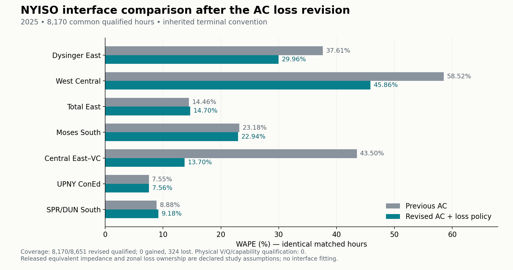

# 2025 AC impedance and loss-accounting revision

The versioned 148-bus replay is complete: **8,170 of 8,651 source-eligible hours** pass the revised AC equations, exact recovery and declared loss accounting. The fair old/new comparison uses **8,170 common hours**, with 0 newly qualified hours and 324 prior successes lost. There were 0 solver exceptions. **0 hours pass the joint voltage/reactive/generator-capability gate.** These are conditional synthetic AC results, not a fully feasible or as-built NYISO model.

## Impedance finding and implemented scope

Parent 224 (Gilboa bus 38 to Buchanan bus 77) was added by Cornell NYgrid as an E–G representation of the Marcy South corridor. It is absent from the original NPCC and S7 branches and is not an identified direct physical circuit. The pinned author code releases `(R,X,B)=(0.02,0.0147,0)` pu on 100 MVA. The paper's `47 miles × 0.371 ohm/mile / 1190.25 ohm` gives `X=0.0146498635` pu, within 0.342% of the released approximation; 0.0147 is not the exact four-decimal rounding of those displayed inputs. Neither the source R nor B has a recovered asset derivation. Historical detailed circuits connect Gilboa to Fraser, Leeds and New Scotland; those records do not identify a direct Gilboa–Buchanan asset.

The new overlay restores the complete released tuple in its existing two equal numerical sections and preserves original bus/branch axes. It removes this aggregate's synthetic conductor rating, R(T), and DLR eligibility. The earlier 177.5 km geographic-chord conductor realization has no verified physical identity. Every other branch parameter, dated topology change and bus shunt is preserved. Source provenance is validated; **physical AC impedance remains unvalidated**. No alternative resistance was selected to improve convergence or NYISO error.

Evidence: [source and parameter review](output/nygrid_2025_ac_loss_revision/impedance/impedance_recommendation.json), [actual implementation audit](output/nygrid_2025_ac_loss_revision/impedance/actual_case_implementation_review.json), [pinned original author code](https://github.com/AndersonEnergyLab-Cornell/NYgrid/blob/47698b6c7823ae7b1bc6935e5601d5b64b8f918e/modifyMPC.m), and [archived paper](output/nygrid_2025_ac_loss_revision/impedance/sources/NYgrid_published_paper.pdf).

## Loss policy and scientific assumptions

NYISO's actual zonal load is calculated as generation plus net interchange. The 2025 Market Participants User's Guide v16, effective May 29, confirms the same definition used by the current guide. Thus the model treats P58 actual load as a loss-inclusive boundary balance: `served_PD_z + allocated_NY_loss_z = frozen_P58_z`. It does not add all AC losses to the tiny Clay reference generator while keeping loss-inclusive demand untouched.

Within-NY corridor losses are split equally between endpoint zones. This is a declared accounting rule, not NYISO's observed metering assignment. Served load follows the existing within-zone spatial shares, and Q demand follows the inherited power factor. ISONE, Ontario and PJM generators supply their internal and NY-border corridor losses using frozen participation weights and their original finite P bounds. External delivered-load proxies remain fixed, so net imports at the NY terminals remain the original targets. Native PG, signed HQ injection and all six DC transfers remain fixed. External Q-circle assumptions are updated with PG, but Q limits are not enforced by the PF.

Evidence: [frozen policy contract](output/nygrid_2025_ac_loss_revision/policy_evidence/loss_accounting_policy_contract.json), [verified 2025 definition supplement](output/nygrid_2025_ac_loss_revision/policy_evidence/historical_definition_supplement.json), and [NYISO guide](https://www.nyiso.com/documents/20142/3625950/mpug.pdf). The source definition supports the balance equation; the spatial loss ownership, external proxy capabilities and estimated delivered load remain modeling assumptions.

The default solver jointly solves voltage and loss-dependent injections, with analytic derivatives and domain-preserving line search. All variable injections remain on the 148 retained buses. Original branch currents and voltages are recovered through the complex-admittance lift. It performs no full-network Newton solve inside the compact annual path and no OPF or observation fitting. A failed step near zero delivered demand is retained as a failed attempt, not promoted or interpreted as proof of global infeasibility.

## Annual NYISO comparison

All 8,760 clock positions remain in the delivery. The original 109 source-excluded hours are retained as excluded. The seven inherited interface cuts, gamma, clock alignment and three terminal conventions were frozen before inspecting revised results. The table uses the inherited signed-literal-from convention and the same 8,170 common qualified hours for both columns. Aggregate power is divided by gamma; amperes are never rescaled. Physical P32 meter membership and the inherited numeric-as-MW interpretation remain uncertified.

| Interface | Previous WAPE | Revised WAPE | Change (pp) | Previous bias (public MW) | Revised bias (public MW) |
|---|---:|---:|---:|---:|---:|
| DYSINGER EAST | 37.61% | 29.96% | -7.64 | -209.8 | +5.0 |
| WEST CENTRAL | 58.52% | 45.86% | -12.67 | -218.0 | +2.3 |
| TOTAL EAST | 14.46% | 14.70% | +0.23 | +46.8 | -326.0 |
| MOSES SOUTH | 23.18% | 22.94% | -0.24 | -5.5 | +11.8 |
| CENTRAL EAST - VC | 43.50% | 13.70% | -29.80 | +739.9 | +172.4 |
| UPNY CONED | 7.55% | 7.56% | +0.01 | +24.1 | -15.8 |
| SPR/DUN-SOUTH | 8.88% | 9.18% | +0.30 | -37.4 | -62.4 |

The [complete metrics](output/nygrid_2025_ac_loss_revision/comparison/combined/public_interface_metrics.csv) include annual, monthly and post-Dover results; all three terminal conventions; revised-all, paired, newly qualified and lost cohorts. The [hour-level cohort ledger](output/nygrid_2025_ac_loss_revision/comparison/combined/comparison_cohort.csv) prevents a change in solver coverage from being hidden inside the error comparison. These scores assess agreement with the public series, not impedance truth.

The earlier CENTRAL EAST WAPE of 45.04% used all 8,494 old successes. Restricting that unchanged old result to the current common 8,170 hours gives 43.50%; the revised 13.70% must be compared with this matched value. The cohort change is reported separately from the model change.

An additional 14-hour four-cell check evaluates old impedance/old loss treatment, revised impedance alone, revised loss policy alone and both changes. Eleven hours qualify in all four cells. On only those selected hours, mean CENTRAL EAST flow changes are -126.83 public MW for the full released impedance tuple alone, -595.01 MW for the loss policy alone, and -63.12 MW for their interaction, summing to -784.96 MW. This is a representative flow decomposition, not annual WAPE attribution or a physical parameter fit. [All cases and explicit failures](output/nygrid_2025_ac_loss_revision/validation/representative_factorial/factorial_checks.csv) and [common-hour arithmetic](output/nygrid_2025_ac_loss_revision/validation/representative_factorial/common_success_attribution.csv) are retained.

## Closure, rejected hours and physical limits

On qualified hours, maximum original-native PG change is 1.86e-10 model MW; maximum zonal served-plus-loss error is 4.55e-13 MW; maximum regional net-import error is 9.07e-10 MW. Total modeled AC loss averages 339.503 MW and reaches 1024.652 MW. These closure checks are constraints of the model, not independent validation of actual delivered load or loss measurements.

The 481 rejected source-eligible hours have statuses `{"NY_delivered_load_domain_boundary": 16, "coupled_line_search_failed": 465}`. Failed/partial arrays and iteration traces are saved and excluded from all prediction checks. No negative NY delivered demand is accepted. There is no hidden slack fallback, loss clipping, or capacity expansion.

| Zone | Mean assigned loss (model MW) | Maximum loss / gross target | Minimum served PD (model MW) | Hours with loss fraction >25% |
|---|---:|---:|---:|---:|
| A | 4.548 | 1.67% | 366.293 | 0 |
| B | 1.975 | 4.29% | 150.869 | 0 |
| C | 13.755 | 12.22% | 224.677 | 0 |
| D | 4.227 | 23.84% | 88.530 | 0 |
| E | 38.506 | 94.52% | 5.059 | 802 |
| F | 80.916 | 95.45% | 14.731 | 2,733 |
| G | 23.674 | 41.17% | 94.773 | 32 |
| H | 0.635 | 2.71% | 52.223 | 0 |
| I | 2.047 | 3.16% | 123.211 | 0 |
| J | 7.605 | 1.10% | 1099.219 | 0 |
| K | 1.424 | 0.78% | 369.028 | 0 |

The maximum loss fraction is **95.45%**; 3,131 qualified hours have at least one zone above 25%. Such large modeled fractions are a warning about the unresolved network equivalent, loss ownership and synthetic operating assumptions. They are not measured NYISO transmission losses. Across qualified cases voltage spans 0.841226–1.120005 pu. All 8,170 fail the joint V/Q/capability gate. This revision fixes the stated real-power accounting contract but does not repair inherited voltage controls, reactive capability, conductor identity or full operating feasibility.

The unresolved parent-224 equivalent alone dissipates 0.786–172.527 model MW (mean 39.136 MW). Its resistance therefore remains a consequential research limitation even after removing the unsupported conductor interpretation.

## Verification and reproducibility

The annual run took 719.1 seconds and checks source/code/MATPOWER hashes before and after the run. Independent checks cover original-branch laws, full-network KCL, all three recovered current columns, passive-bus voltage recovery, original non-224 parameters and dated source masks. The contract suite has 24 cases; the analytic Jacobian has 10 finite-difference cases. Compact and detailed coupled solvers agree on the 11 qualified cases among 14 representative hours; both reject the same three stress cases. A conventional detailed PF on each of the 11 qualified representative final allocations independently verifies the resulting network solution. This is a conditional numerical-equivalence result, not 14 successful physical cases or a second full-year conventional PF replay.

The [independent annual array review](output/nygrid_2025_ac_loss_revision/impedance/released_equivalent_boundary_consistent_annual_arrays_independent_review.json) verifies all 12 months against separately reconstructed branch admittances and original source accounting. It also records equivalent losses, positive-demand checks and every rejected hour. Current recovery is validated on original branch sections and does not create verified amperes for an unidentified installed conductor.

Use the [public MATLAB entry point](System%20Matpower%20Format/run_nygrid_2025_loss_consistent_acpf.m) and [reproduction guide](scripts/nygrid_2025_ac_loss_revision/README.md). The delivered annual [producer receipt](output/nygrid_2025_ac_loss_revision/validation/annual/released_equivalent_boundary_consistent/annual_loss_policy_receipt.json) and [scoring receipt](output/nygrid_2025_ac_loss_revision/comparison/combined/scoring_receipt.json) identify exact inputs and cohorts. The [delivery manifest](output/nygrid_2025_ac_loss_revision/DELIVERY_MANIFEST.json) seals the new namespace and verifies previous model deliveries remain byte-preserved.

Historical fixed-point prototypes, stress attempts and source-download failures are retained and explicitly classified. They are not current solver qualification. Current evidence is the simultaneous-solver validation, completed annual replay and independent final audits.
