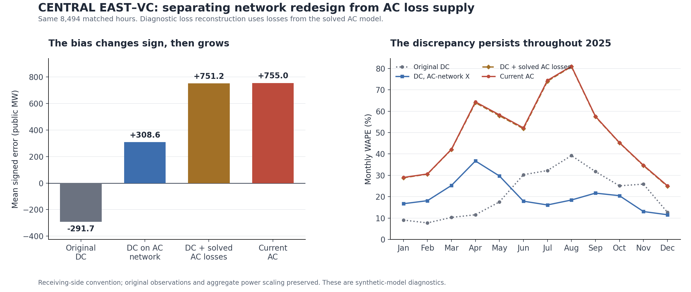

# Why CENTRAL EAST–VC WAPE increased from DC to AC

The increase is a systematic switch from underprediction to overprediction. Two effects explain almost all of the mean flow change: **reactance-driven rerouting adds 600.32 public MW**, and **a reconstruction that explicitly supplies the solved AC losses adds 442.57 public MW**. The remaining mean difference is 3.75 MW. The observed hourly benchmark, cohort, interface signs and compact reduction do not explain the increase.

The earlier DC and AC results used different network parameterizations. A same-network DC intermediate is therefore necessary to separate network construction from AC effects. All results below use the **same 8,494 hours** and the inherited receiving-side CENTRAL EAST functional. Source data and all production model/evidence files remain unchanged; these are separate diagnostic cases, with no OPF or observation fitting.

## Reproduced change and controlled comparison

| Stage | Mean flow, public MW | Mean error, public MW | WAPE |
| --- | --- | --- | --- |
| Original network, DC | 1384.28 | -291.70 | 18.5268% |
| AC network parameters, DC | 1984.60 | +308.62 | 19.8631% |
| AC network, DC plus half-end AC losses | 2427.18 | +751.20 | 44.8120% |
| Current AC solution | 2430.93 | +754.95 | 45.0359% |

The public observed mean is 1675.98 MW; the mean absolute observed flow, which supplies the WAPE denominator, is 1676.35 MW. WAPE is `100 * sum(abs(model - observed)) / sum(abs(observed))`, not an average of hourly percentages.

Construction moves the signed error from −291.70 to +308.62 MW but raises WAPE by only **1.3363 percentage points**, because the error changes sign. Moving from that same-network DC solution to AC adds **25.1728 percentage points**. Consequently, shares of mean flow displacement must not be described as shares of the WAPE increase.



The original DC score over all 8,651 source-qualified hours is 19.0256%, versus 18.5268% on the matched 8,494 hours. Excluding the 157 failed-AC hours slightly improves the DC score; it cannot account for the matched-cohort 26.5091-point increase. The compiled public CE series was also independently reconstructed from the original P32 archives, including the clock rewind and hourly aggregation. [Measurement/source evidence](output/nygrid_2025_centraleast_diagnosis/measurement/raw_source_check.json).

## 1. A parallel route was substantially weakened

The CENTRAL EAST comparison uses original signed branch rows `[-33, -36, -40, -42]`, oriented E→F. Their total reactances are unchanged. Series sections preserve those totals, and the recovered original-terminal operator reproduces the archived DC functional. The recently built 148-bus AC reduction also reproduces the detailed AC results to numerical precision.

The consequential change occurs on **row 224, Gilboa–Buchanan**, a parallel E→G path. It is included in TOTAL EAST but is absent from CENTRAL EAST. Its 100-MVA-base reactance increases from **0.0147 to 0.055458 pu**, a **3.7726-fold increase**, during synthetic conductor construction. The stronger impedance on that bypass redirects flow toward the CENTRAL EAST routes.

Across all 8,494 hours, restoring only row 224's former X in the DC diagnostic removes **581.57 MW**, or **96.88% of the mean construction-induced displacement**. The remaining displacement is 18.75 MW. That diagnostic's WAPE is 17.5441%. Restoring all 33 changed reactances reproduces the original DC results across all seven interfaces. Restoring row 41's X alone has no DC flow effect: it connects a pendant Albany bus.

The code used a fallback geometric prior because it could not realize the original R/X pair with the searched conductor/geometry candidates. For row 224, the original-X-implied length is 47.060 km, below the declared 71.016-km lower bound. The implementation selects the **177.539-km preferred length**, 1.25 times an approximate geographic chord. This is not a measured route, installed conductor identification or factory impedance. Its helper docstring's “nearest length boundary” description does not match that preferred-length behavior. The diagnostic records the executed behavior without modifying the old code.

[Parameter/operator audit](output/nygrid_2025_centraleast_diagnosis/model_delta/model_delta_review.json), [fallback provenance](output/nygrid_2025_centraleast_diagnosis/model_delta/fallback_provenance_review.json), [annual X experiment](output/nygrid_2025_centraleast_diagnosis/experiments/annual_DC_bridge/annual_DC_bridge_receipt.json), and [independent annual DC reconstruction](output/nygrid_2025_centraleast_diagnosis/model_delta/annual_DC_independent_review.json).

## 2. The reference generator supplies the omitted AC losses

The supplied active-power profiles balance demand before AC losses. In the AC run, the original reference generator at **bus 50, CLAY, zone C**, supplies the entire extra real-power requirement while other generators and the six transfer targets remain fixed. Mean whole-network loss is **312.396 model MW**. This is distinct from the interface flow changes reported on the public scale.

To test this mechanism, the experiment takes the already-solved AC loss `PF + PT` on each original runtime branch, assigns half as an additional withdrawal at each end, and solves DC on the same network. It preserves the other active injections and controls. The reference increase equals the original AC loss, and the resulting CENTRAL EAST displacement is **442.57 public MW**. This reconstructs **99.16% of the mean same-network AC–DC displacement**. Its mean absolute difference from AC is 4.22 MW, with a maximum of 21.49 MW.

The allocation is a diagnostic convention. Assigning all loss to the original from ends or all to the original to ends changes the mean interface increment to 439.96–445.19 MW. These alternatives are not confidence bounds. Because the reconstruction uses solved AC losses, it is not an independent forecast or a unique causal decomposition of resistance, voltage and reactive-power effects. The small residual contains the remaining full-admittance/voltage/angle differences and the chosen loss-allocation convention.

[Annual loss reconstruction](output/nygrid_2025_centraleast_diagnosis/experiments/annual_loss_loaded_DCF/annual_loss_loaded_receipt.json) records all 25,482 allocation-case solves. The [stage metrics](output/nygrid_2025_centraleast_diagnosis/summary/stage_metrics.csv) include every month and allocation, with the fixed cohort retained.

## Excluded explanations and interpretation limits

- Changing the terminal convention does not remove the discrepancy. The inherited negative-from sum equals receiving-side flow for these four negatively signed members; source-side WAPE is 45.9933%, only 0.9573 points above 45.0359%. Mean separation is 16.05 public MW.
- The large increase is mainly a route redistribution plus a smaller increase in total eastward transfer. The exact inherited relation is `TOTAL EAST = CENTRAL EAST + row224 contribution`. CE rises by 1,046.65 public MW while the bypass contribution falls by 746.84 MW; TOTAL EAST rises by only 299.81 MW. This is accounting support, not an independent causal experiment.
- The source generator relocations, six-transfer controls, branch-211 substitution and dated topologies are already shared by the DC and AC comparators. They are not newly introduced AC differences. No duplicated sections, double-applied reactors or direct CE-X change was found.
- X-only AC restorations are deliberately mixed parameter sets, not approved fixes. In particular, restoring row 41's former X while retaining its redesigned R produces R/X≈6.72; an all-X-only restoration reaches about 1.70 pu in the selected AC tests. Lower WAPE does not validate an impedance or operating state.
- The coherent original-parent AC and zero-resistance experiments are selected-hour diagnostics, not annual results. Original-parent AC converges in all 11 selected cases; zero-resistance AC qualifies in only 5. Failed trials remain flagged and are excluded from solution claims.
- None of the baseline annual AC solutions passes the combined voltage/generator/converter assumptions. The inherited physical P32 meter membership and numeric interpretation of `Flow(MWH)` also remain uncertified. This investigation establishes why these model outputs differ, not which parameter set represents the actual grid.

The next model-development step is to validate the Gilboa–Buchanan equivalent/route assumptions and construct an AC loss-balanced generation/interchange policy with defensible participation, then reassess the seven interfaces and physical operating limits together. The diagnostic X restoration should not be promoted merely because it lowers this one error metric.

## Reproduction and evidence boundary

The [summary receipt](output/nygrid_2025_centraleast_diagnosis/summary/diagnosis_summary.json) binds the original saved comparisons and both annual experiments. [Hourly comparison rows](output/nygrid_2025_centraleast_diagnosis/summary/hourly_stage_comparison.csv) retain all 8,760 positions and explicit matched-hour flags. Methods are in `scripts/nygrid_2025_centraleast_diagnosis`; experiment runners use the existing MATLAB/MATPOWER environment and preserve failed diagnostic trials separately.

To regenerate the summary and scientific figure after completing the saved diagnostic runners:

```powershell
python scripts/nygrid_2025_centraleast_diagnosis/build_diagnosis.py
```

The [delivery manifest](output/nygrid_2025_centraleast_diagnosis/DELIVERY_MANIFEST.json) binds this investigation and verifies the prior AC, profile-audit and compact-model files against commit `6dcc77f071a9ce4aaaa2fcba9a9aabc15f7d5dbc`. Rebuilding outputs requires a fresh review and manifest seal; it does not update the production model.
