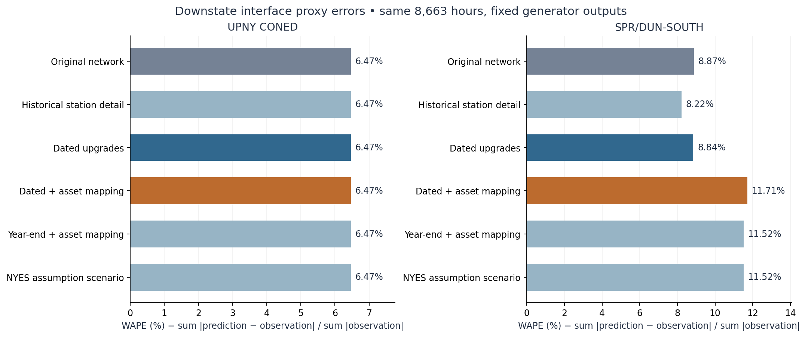

# 2025 Downstate refinement on the full NPCC backbone

**Completed 2026-10-10.** The new DC research model retains all 140 original
NPCC buses and expands the network to **191 buses**, using the frozen 2025
fleet and capacity-bounded dispatch. All **8,663 qualified hours** were replayed
in seven controlled variants; the same 97 source-gap hours remain unavailable.
The original baseline and earlier models are preserved.

The dated upgrade case changes Sprain/Dunwoodie WAPE from **8.87% to 8.84%**.
UpNY-ConEd remains **6.47%** because fixed net injections determine its complete
cut flow. The optional plant/load placement scenario gives **11.71%**
Sprain/Dunwoodie WAPE, so added spatial detail has not established improved
accuracy. These are comparable inherited interface proxies, not certified
physical 2025 flowgates.

Use [npcc_nygrid_2025_downstate_dc.m](System%20Matpower%20Format/npcc_nygrid_2025_downstate_dc.m)
for hourly cases. Its default, `upgrades_dated`, retains the baseline injection
landings. The [workflow README](scripts/nygrid_2025_downstate/README.md) gives
exact loading, rebuilding and validation commands.

## What was constructed

The parent is commit `c7874aa90fec1d4e883814297e91bfcd3567bdf2`: the modified-2019
full NPCC network with the new 2025 fleet and dispatch. Its 1,436 native
generator rows, 28 fixed external/HQ equivalents, hourly PG and bounds, four
signed DC schedules, and accounting zones remain fixed. The model retains the
user-selected scale **gamma = 0.30012075175285535**. All error tables below use
public-equivalent MW: model MW divided by gamma.

The expansion adds 51 station terminals: 38 from historical electrical source
detail and 13 public project/plant or explicit proxy terminals. The common
branch axis has **410 records**. The core refined cases deactivate nine
predecessor aggregate rows—32, 87, 88, 89, 91–95—while retaining their records
and all original buses. Replacement paths are registered rather than adding
full detailed paths in parallel with the old aggregate. The year-end core has
**336 active AC branches**; the separate NYES assumption case has 337.

There are **97 exact historical PERFORM circuit rows**, with R, X, B, ratings,
taps, shifts and status preserved. Only angle bounds are neutralized. Positive
aggregate attachments and project impedances without released values are
explicit assumptions; their numeric values are in the
[branch register](output/nygrid_2025_downstate/network/branch_register.csv).
The [replacement register](output/nygrid_2025_downstate/network/replacement_register.csv)
and [overlap audit](output/nygrid_2025_downstate/network/overlap_policy_audit.csv)
record the selected partition. No assumed active edge duplicates an exact
source endpoint pair, but the physical partition of a coarse aggregate is not
uniquely established by these checks.

An algebraic expansion control reproduces the parent DC response before any
source-detail substitutions. Its Schur-matrix error is **7.276e-12 model
MW/radian**, with zero affine phase-source discrepancy. This establishes the
control's DC equivalence; the detailed cases intentionally have a different
network response and do not claim AC equivalence.

## Projects, chronology and scope

The [source audit](output/nygrid_2025_downstate/sources/upgrade_register.csv)
contains 32 records and 36 source receipts, with 30 locally preserved source
files and six primary-web receipts whose direct downloads were blocked.

| Included representation | Dated replay treatment | Qualification |
|---|---|---|
| Cricket Valley tap of the Pleasant Valley–Long Mountain corridor and parallel F84 | In service throughout 2025 | Public endpoints/topology; split equivalent impedances are assumed |
| Rainey–Corona transformer/PAR/cable path | In service throughout 2025; completed May 3, 2023 | Public project facts; nominal tap/phase and template impedances |
| Gowanus–Greenwood RCC addition | Activates May 21, 2025, 00:00 local | NYISO reports May 20 completion; next midnight is a conservative day-precision convention |
| Goethals–Fox Hills RCC addition | Activates May 30, 2025, 00:00 local | NYISO reports May 29 completion; same convention |
| Dover Y17/398 route reconfiguration | Activates December 19, 2025, hour beginning 23 EST | Operator commissioning record; internal PAR configuration/settings remain unresolved |
| South Fork plant terminal | East Hampton 69 kV available to the optional asset map | Export voltage and terminal voltage are distinguished; omitted local network is an explicit proxy |

The commissioning evidence includes the operator's
[May 2025 operations report](https://www.nysrc.org/wp-content/uploads/2025/06/7.3.2-Operations_Report_202505_v1-long-form-Attachment-7.3.2.pdf)
and the preserved [December report](output/nygrid_2025_downstate/sources/raw/nyiso_dec2025_operations.pdf).
The [2020 NYISO/ISO-NE study](https://www.nyiso.com/documents/20142/3694233/NY-NE-Stability-Analysis-FINAL.pdf/8be950c7-6e2e-1a75-c232-7d0c0d7839d1)
supports the Cricket Valley circuit arrangement. Parent bus 35 is **Southington**,
so Long Mountain is a new terminal joined through a declared boundary equivalent.
It was not created by relabeling Southington.

NYES is present only in `nyes_assumption_year_end`: overlap between the real
project and the old Leeds–Pleasant Valley aggregate is unresolved. The primary
cases retain both original corridor contributions. Churchtown is not invented
as a 345 kV station. CEEC and partial upstate SPC scope remain source-register
items outside this focused construction. Future CHPE and Propel equipment is
not treated as operating in 2025. The RCC project's reported 300 MW benefit is not
used as a 300 MVA branch rating.

## Conservative optional injection placement

The asset variants relocate **38 existing generator rows** using reviewed plant
terminals: Bayonne/Gowanus, Linden/Goethals, Astoria Energy I/East Astoria 138,
Astoria Energy II/NYPA Annex 345, Cricket Valley, South Fork/East Hampton,
Ravenswood/Vernon or Rainey, and Arthur Kill/Fresh Kills at the documented voltage.
Per-device hourly PG, availability and capacity bounds do not change. See the
[generation landing register](output/nygrid_2025_downstate/network/generation_landing_register.csv).

Load placement uses historical source-PD shares of the **full source-zone
total**, not shares normalized over a small selected subnetwork:

| Zone | Demand allocated to explicit source stations | Remainder retained at original buses |
|---|---:|---:|
| I | 89.6272% | 10.3728% |
| J | 63.9002% | 36.0998% |
| K | 5.8757% | 94.1243% |

Both gross P and Q totals are conserved by zone. Every selected loaded K
terminal has a K-only source-backed path to an original K anchor. During
validation, an initial partial-subnetwork allocation was rejected because it
concentrated all K demand at a handful of stations, including two lacking their
omitted K connections. The corrected construction adds six K source buses and
14 exact source circuits, and preserves the unrepresented load remainder.
The superseded intermediate is retained locally as diagnostic history.

These historical spatial shares are **not observed 2025 nodal demand**.
Buchanan retains its parent accounting zone G even though the source terminal
is labeled H; this disclosed exception preserves the comparison's accounting
definition. The four DC endpoints remain at baseline proxies. A separate
[merchant landing crosswalk](output/nygrid_2025_downstate/sources/merchant_boundary_landing_crosswalk.csv)
records physical terminals without moving them or double-counting the combined
CSC/1385 schedule. The physical 1385 connection is AC, despite its representation
inside the inherited scheduled-transfer equivalent.

## Before/after interface results

All rows use the same 8,663 hours and seven inherited zone-crossing functionals.
No observation selected the dispatch, network parameters, load shares or plant
landings. WAPE is `100 × sum(abs(prediction − observation)) / sum(abs(observation))`.

| Interface proxy | Baseline WAPE | Dated topology WAPE | Dated topology + asset map WAPE | Baseline → dated topology MAE, public-equivalent MW |
|---|---:|---:|---:|---:|
| Dysinger East | 52.28% | 52.37% | 52.36% | 438.62 → 439.38 |
| West Central | 79.03% | 79.17% | 79.16% | 440.36 → 441.14 |
| Total East | 12.44% | 12.68% | 12.69% | 389.51 → 397.07 |
| Moses South | 95.14% | 95.36% | 95.35% | 513.57 → 514.77 |
| Central East | 27.27% | 17.67% | 18.20% | 453.76 → 294.10 |
| UpNY-ConEd | 6.47% | 6.47% | 6.47% | 193.84 → 193.84 |
| Sprain/Dunwoodie South | 8.87% | 8.84% | 11.71% | 163.89 → 163.31 |

Central East improves substantially under the assumed refinement, while Total
East and the already poor western/Moses proxies regress slightly. This does
not certify the physical network. In the staged controls, Sprain/Dunwoodie is
8.22% for historical station detail, 8.96% for fixed year-end topology and
11.52% for year-end topology plus asset placement. A full-year year-end case is
a counterfactual; the dated replay is the historical-timing comparison.

The [independent cut-balance proof](output/nygrid_2025_downstate/validation/upny_cut_balance_diagnostic.json)
shows UpNY equals demand minus generation minus signed DC inflow within H–K
for every case and hour. Those quantities are fixed. Its unchanged score is
therefore required by conservation and provides no evidence that the added
topology is accurate. Sprain/Dunwoodie counts I-to-J crossings and is sensitive
to alternate J–K paths and spatial placement.

The [complete score table](output/nygrid_2025_downstate/comparison/interface_summary.csv),
[monthly table](output/nygrid_2025_downstate/comparison/monthly_interface_summary.csv),
[staged flow changes](output/nygrid_2025_downstate/comparison/staged_flow_changes.csv),
and [monthly figure](output/nygrid_2025_downstate/comparison/downstate_monthly_comparison.png)
retain both improvements and regressions. PDF versions accompany both figures.

## Sensitivity and validation

Thirteen electrical-parameter scenarios vary declared project/proxy X values
by 0.5 and 2, jointly and separately, and explicit RCC loop PARs by ±5 degrees.
Six additional mapping controls separate generator relocation, total load
placement, and zones I/J/K. No scenario is selected by its error against
observations. The parameter-only range of annual mean flow is about **36.83
public-equivalent MW for Sprain/Dunwoodie** and **21.96 MW for Central East**;
maximum hourly scenario spreads are 42.81 and 90.86 MW respectively. These are
declared scenario ranges, not confidence intervals or exhaustive uncertainty
bounds. [Sensitivity evidence](output/nygrid_2025_downstate/sensitivity/scenario_envelope_summary.csv).

On the fixed year-end network, generator relocation changes mean
Sprain/Dunwoodie flow by −34.95 public-equivalent MW; load placement contributes
−51.43 MW, for −86.38 MW combined. Independent linear-superposition checks
separate those effects without redispatch. This helps explain the optional
asset scenario's greater underprediction; it does not validate the nodal shares.

Fresh checks establish:

- **28 focused tests** pass, including tap/phase identity, source mutation
  rejection, duplicate/overlap guards, partial-load coverage, K connectivity,
  chronology and fixed-cohort scoring.
- Independent construction checks preserve all original identities and verify
  all 97 source circuits, conservative allocations and 38 plant landings.
- **60,641 independent annual solves** (seven times 8,663) pass. Maximum nodal
  residual is 2.98e-10 model MW; independent branch-flow disagreement is
  1.50e-10 model MW. All 56 published score rows match independent recalculation.
- **131 fresh MATPOWER snapshots** span seasons, peak/valley, DST, and every
  topology state. Maximum branch discrepancy is 2.52e-10 model MW, generation
  change 2.83e-10 model MW and bound violation 2.28e-13 model MW. Missing-source
  hours are rejected.
- A separate clean construction rebuild matches 14 artifact payload/CSV
  checks exactly, with MAT creation-header and output-path differences declared.
- All seven raw case interface maps were checked against active refined
  branches. A metadata-only correction was independently shown to leave 77
  electrical/injection payload fields unchanged.

Evidence: [construction](output/nygrid_2025_downstate/validation/construction_validation.json),
[annual replay](output/nygrid_2025_downstate/validation/annual_validation.json),
[MATPOWER](output/nygrid_2025_downstate/validation/matlab_validation.json),
[focused tests](output/nygrid_2025_downstate/validation/focused_tests.json),
[clean rebuild](output/nygrid_2025_downstate/network/rebuild_verification.json).

The model is usable for **controlled fixed-dispatch DC research**. Exact
as-built project impedances, PAR schedules, physical flowgate membership, nodal
demand, and complete merchant landing decomposition remain unresolved. AC
voltage/reactive feasibility, commitment/ramping, storage energy, physical
thermal ratings and DLR qualification have not been established. The frozen
baseline remains the comparison reference; no statewide 2025 model promotion
is implied by this refinement.
