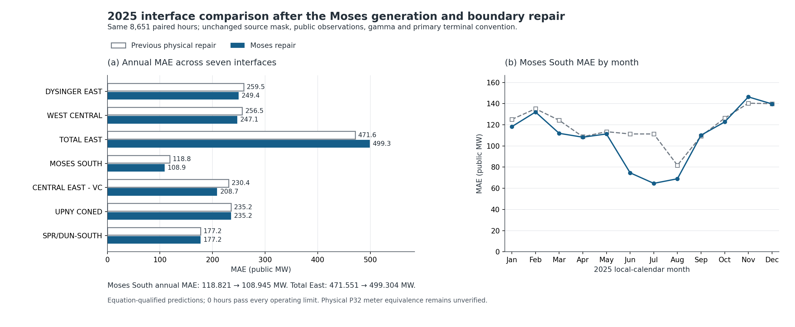

# Moses South improves after a source-constrained generation and boundary repair

The completed 2025 replay reduces Moses South mean absolute error (MAE) from **118.821 to 108.945 public MW (8.31%)** on the same 8,651 hours as the previous physical-repair model. WAPE falls from **22.0076% to 20.1784%**. This is a conditional, equation-qualified improvement: Moses South positive bias increases, Total East accuracy worsens, and **no hour passes every network operating limit**. Physical equivalence to the public P32 Moses South meter remains unverified.

This revision makes two source-supported changes: it reconstructs St. Lawrence generation under exact final-EIA monthly energy constraints, and explicitly routes the observed Sand Bar P34 boundary proxy into the northern pocket without changing the ISO-NE regional interchange total. The earlier parent 41 and parent 185/195 physical repairs are preserved. The generation policy and boundary sign were selected from source evidence before this comparison, without fitting their values to P32 errors. The combined replay does not separately identify the causal contribution of each repair.



The [vector PDF figure](output/nygrid_2025_moses_repair/summary/moses_repair_comparison.pdf), [annual figure data](output/nygrid_2025_moses_repair/summary/annual_paired_comparison.csv), and [monthly figure data](output/nygrid_2025_moses_repair/summary/monthly_moses_comparison.csv) are reproducible from the final comparison CSV. All results below are fresh saved-run readbacks, completed on 2026-10-15; source documents retain their original dates.

## Generation repair: monthly energy is observed; hourly dispatch is reconstructed

Final EIA-923 plant 2694 HY net generation totals **6,726,939 MWh** in 2025. The candidate satisfies each of the 12 monthly totals over all physical hours in its New York calendar month, including the explicitly modeled energy of excluded hours. The maximum monthly energy error is **2.33e-10 MWh**. It does not force the full monthly total onto the smaller PF-qualified subset.

EIA inventory supports 16 dated unit records, with 15 operating units in each month: unit 21 is operating in January–February while unit 26 is out of service; their status reverses from March through December. Unit 21 is appended as native generator row 1465 at model bus 48, preserving all original row identities. The upper bound **15 × 57 = 855 MW** uses operating-unit nameplate ratings as an engineering bound. It is not an observed hourly net capability or availability trace.

The plant profile is the unique unweighted minimum-squared-deviation reconstruction around the existing reconciled plant profile, subject to exact monthly energy and hourly feasible intervals. Dispatch among the 15 active equal-nameplate units is proportional to nameplate. Other HY units are redistributed by a bounded weighted least-squares projection using the frozen objective weights. These are declared reconstruction rules, not unit telemetry. The cap binds in many April–October hours, so monthly energy agreement alone does not validate the resulting hourly shape.

| Month | Calendar hours | Qualified hours | EIA target MWh | Reconstructed MWh | Hours at 855 MW |
| --- | --- | --- | --- | --- | --- |
| Jan | 744 | 738 | 548,674 | 548,674 | 0 |
| Feb | 672 | 661 | 461,660 | 461,660 | 0 |
| Mar | 743 | 735 | 548,560 | 548,560 | 0 |
| Apr | 720 | 714 | 585,879 | 585,879 | 367 |
| May | 744 | 729 | 627,947 | 627,947 | 593 |
| Jun | 720 | 710 | 614,252 | 614,252 | 657 |
| Jul | 744 | 729 | 619,612 | 619,612 | 524 |
| Aug | 744 | 732 | 583,545 | 583,545 | 420 |
| Sep | 720 | 716 | 545,689 | 545,689 | 307 |
| Oct | 744 | 740 | 566,745 | 566,745 | 351 |
| Nov | 721 | 710 | 486,125 | 486,125 | 0 |
| Dec | 744 | 737 | 538,251 | 538,251 | 1 |

The current **reconciled** hourly NY HY total and total native PG are preserved on every qualified hour, as are other native fuels, pumped-storage positive-generation profiles, HQ, load, existing Ontario PAR/DC targets, and regional net-import targets. Raw P63 Hydro is a different series: the previous reconciled total differs from it by mean **-3.803372 MW** and MAE **4.886582 MW**. Exact preservation of raw P63 is not claimed.

All 109 previously excluded hours remain excluded: six retain available reconciled targets; 93 use the frozen HY prior and observed P63 total; ten P63-gap hours use explicitly declared bracketed linear interpolation only for the latent energy ledger. The [generation policy](output/nygrid_2025_moses_repair/generation/generation_policy.json), [monthly ledger](output/nygrid_2025_moses_repair/generation/StLawrence_monthly_energy_ledger.csv), [candidate receipt](output/nygrid_2025_moses_repair/generation/candidate_receipt.json), [independent generation review](output/nygrid_2025_moses_repair/generation/independent_generation_review.json), and [excluded-hour energy sensitivity](output/nygrid_2025_moses_repair/generation/excluded_hour_energy_sensitivity.csv) distinguish these constraints and assumptions.

## Northern boundary: missing routing is repaired, while meter equivalence remains conditional

The 2024 NYISO MS24 study's Figure 2 documents the North NYCA pocket connections to HQ, Cedars, Ontario PAR33/34, PV20 toward ISO-NE, and seven Moses South paths to Main NYCA. Together with the seasonal definitions, it supports PV20 as a separate D-to-N path: it contributes to Central East and Total East and is absent from the seven-term Moses South list. The baseline aggregate northern cut contained model parents 46/51/52 and the prescribed HQ/Ontario transfers but no explicit PV20 injection. This is structural evidence for the missing boundary component, not a complete bus-level injection or physical-meter crosswalk.

Native P34 PTID 325270, Sand Bar PAR PS01, contains 105,998 observations and covers 8,673 complete hours, including all 8,651 qualified model hours. Its mean on the qualified cohort is **−75.9885 public MW** under the current diagram's positive direction toward Plattsburgh/NY; the negative mean therefore denotes net export from NY under that convention. The source series is inserted at aggregate Plattsburgh bus 49 as generator row **1466**, with fixed P, **Q = 0**, Pmin = Pmax, no native-generation membership, no voltage regulation, and no external loss-balancing share. The existing ISO-NE generation pool receives the opposite adjustment. Each hour preserves:

`ISO_NE_total_import = PV20_proxy_import + ISO_NE_nonPV20_import_target`.

This is a boundary injection with six existing DC records retained; it is not a new DC line or an invented physical AC corridor. No Sand Bar bus, impedance, conductor rating, or PAR tap angle is manufactured.

The [boundary verification receipt](output/nygrid_2025_moses_repair/boundary/boundary_verification_receipt.json) records **22 bindings: 15 verified, 3 assumed, and 4 unresolved**. Its linked primary-source register is the documentary evidence ledger. The [P34 extraction receipt](output/nygrid_2025_moses_repair/boundary/PV20_source_receipt.json), [hourly proxy](output/nygrid_2025_moses_repair/boundary/PV20_hourly_source.csv), and [ISO-NE disaggregation contract](output/nygrid_2025_moses_repair/boundary/ISO_NE_PV20_disaggregation_contract.csv) provide numeric provenance.

The current PAR diagram establishes the sign direction, but it lacks a dated 2025 effective note; applying that sign throughout 2025 remains an assumption. The physical PV20 gate is at Plattsburgh, while the observed meter is at Sand Bar beyond South Hero. The required physical identity is:

`PV20_Platt_import = P34_SandBar_toward_Platt − SouthHero_net_load − intervening_real_losses + bypass_or_unmetered_parallel_transfer`.

South Hero load is documented. Its feeder 29-1A planning peak of 6.66 MVA is neither an hourly total-substation net-load series nor a full bound on meter error. The engineering proxy omits these intervening terms; it does not establish that they are physically zero. A complete dated pocket load/generator/loss census, terminal mapping, bypass history and P32 weights remain unresolved.

NYPA's formal filings establish **HA2 energization on October 13, 2025**, and **HA1 energization on March 27, 2026**. Thus, the winter planning definition cannot establish HA1 operation in 2025. Neither filing supplies the exact P32 switch hour or full intermediate topology; this repair does not infer a simultaneous seasonal meter cutover. The distinction between these documentary dates and measurement-effective intervals is preserved in the source receipt.

## Paired annual and monthly results

The comparator is the completed `physical_repair_v1` model, with 8,651 qualified hours, rather than the older 8,170-hour pre-repair baseline. The clock, source mask, observations, gamma and primary `legacy_signed_literal_from` operator are frozen. Public predictions are aggregate model MW divided by gamma once. Physical currents remain model amperes and are never divided by gamma. WAPE is `100 × sum(abs(prediction − observation)) / sum(abs(observation))`, evaluated over exactly the displayed cohort.

| Interface | Previous MAE MW | Candidate MAE MW | MAE change MW | Previous WAPE % | Candidate WAPE % |
| --- | --- | --- | --- | --- | --- |
| DYSINGER EAST | 259.494 | 249.433 | -10.060 | 30.941 | 29.742 |
| WEST CENTRAL | 256.548 | 247.053 | -9.495 | 46.067 | 44.362 |
| TOTAL EAST | 471.551 | 499.304 | +27.753 | 15.063 | 15.949 |
| MOSES SOUTH | 118.821 | 108.945 | -9.876 | 22.008 | 20.178 |
| CENTRAL EAST - VC | 230.424 | 208.719 | -21.705 | 13.849 | 12.545 |
| UPNY CONED | 235.207 | 235.207 | +0.000 | 7.844 | 7.844 |
| SPR/DUN-SOUTH | 177.242 | 177.242 | -0.000 | 9.592 | 9.592 |

Total East MAE worsens by **5.89%**. The UPNY MAE change is only **+0.000278 MW**; SPR/DUN-SOUTH is unchanged to the shown precision. MAE improvements do not imply bias improvements. Moses South signed mean bias rises from **+12.624497 to +24.319610 MW**:

| Interface | Previous bias MW | Candidate bias MW |
| --- | --- | --- |
| DYSINGER EAST | -5.681465 | -68.488911 |
| WEST CENTRAL | -8.858543 | -71.926054 |
| TOTAL EAST | -285.785565 | -340.157085 |
| MOSES SOUTH | +12.624497 | +24.319610 |
| CENTRAL EAST - VC | +158.033968 | +112.615352 |
| UPNY CONED | -35.764830 | -35.743397 |
| SPR/DUN-SOUTH | -75.479726 | -75.479724 |

Monthly Moses South MAE is lower in ten months but higher in September and November. The largest reductions occur in June and July. This is a paired descriptive result; it does not certify hourly St. Lawrence dispatch, establish a meter operator, or attribute the gain separately to the two simultaneous changes.

| Month | Paired hours | Previous MAE MW | Candidate MAE MW |
| --- | --- | --- | --- |
| Jan | 738 | 125.116 | 118.251 |
| Feb | 661 | 135.142 | 132.057 |
| Mar | 735 | 124.272 | 111.943 |
| Apr | 714 | 108.708 | 108.272 |
| May | 729 | 113.487 | 111.333 |
| Jun | 710 | 111.331 | 74.636 |
| Jul | 729 | 111.339 | 64.666 |
| Aug | 732 | 81.761 | 68.987 |
| Sep | 716 | 109.293 | 110.171 |
| Oct | 740 | 126.267 | 122.695 |
| Nov | 710 | 140.401 | 146.354 |
| Dec | 737 | 139.933 | 139.701 |

The [full metrics](output/nygrid_2025_moses_repair/annual/moses_repair_v1/comparison/public_interface_metrics.csv) retain all seven interfaces, annual/monthly and post-Dover periods, actual success cohorts, and all three predeclared terminal conventions. No alternate convention is selected by best fit. The [scoring receipt](output/nygrid_2025_moses_repair/annual/moses_repair_v1/comparison/scoring_receipt.json) explicitly marks physical P32 membership and the numerical-header-as-MW interpretation as uncertified. These remain diagnostic comparisons.

## Full-year equation validation and remaining physical limits

The annual replay attempted and converged on all **8,651 source-qualified hours**, with no exceptions, no lost baseline successes, and no additional source-qualified hours. All 8,760 clock rows are retained. Runtime was **328.715 seconds**. The saved final [annual receipt](output/nygrid_2025_moses_repair/annual/moses_repair_v1/annual_receipt.json) is completion evidence; earlier files labeled `partial_` are intermediate inspections.

The independent [input/accounting reader](output/nygrid_2025_moses_repair/annual/moses_repair_v1/validation/annual_input_accounting_review.json) validates compiled native/HQ/boundary profiles, finite capability metadata, fixed P/Q, loss ownership, external increments, zonal-load closure and regional imports. Maximum deviation from preserved baseline input constraints is **3e-11 MW**, and from baseline regional net-import targets **2.73e-12 MW**. The explicit boundary P/Q deviation is exactly zero.

The separate [raw-physics reader](output/nygrid_2025_moses_repair/annual/moses_repair_v1/validation/annual_physics_review.json) reconstructs both-terminal complex power and currents from voltage, R/X/B, taps and phase shifts, checks nodal P/Q balance including the six DC records and the new boundary row, rebuilds passive-node voltage recovery, and verifies material I-squared-R loss. Maximum branch-power discrepancy is **2.78e-10 MVA**, maximum nodal P/Q residual is **6.74e-09 MW / 1e-08 MVAr**, and full-voltage recovery discrepancy is **7.02e-14 pu**. The independent [scoring crosscheck](output/nygrid_2025_moses_repair/annual/moses_repair_v1/comparison/independent_scoring_crosscheck.json) matches 28 raw-reader metric rows and direct WAPE recomputation exactly.

Parent 41 R/X/B and thermal realization, parent 185/195 branch parameters, and all fixed-reactor placements remain unchanged from the previous physical repair. Target 185 and 195 voltage violations remain zero across the full cohort; their voltage ranges are **1.020000–1.039389 pu** and **1.006566–1.046987 pu**. Parent 41 mean model loss changes **2.364978 → 2.356207 MW** with the dispatch change; this is not another impedance repair.

System-wide operating violations remain substantial: **8,651 overvoltage hours, 599 undervoltage hours, 8,651 hours with generator Q violations, 8,651 with assumed generator S violations, and 4,793 with branch MVA violations**. Overall voltage spans **0.841226–1.076098 pu**. Parent 41 still exceeds its declared hardware-current limit in **2,712 hours**. Consequently **0 hours pass the full operating gate**. Equation closure and recovery are established; full operating feasibility, physical P32 meter equivalence, and exact historical hourly generation are not.

## Reproduction and use

Use the [portable delivery instructions](output/nygrid_2025_moses_repair/delivery/docs/START_HERE.md) for the model API and limitations. The [data dictionary](output/nygrid_2025_moses_repair/delivery/docs/DATA_DICTIONARY.md) documents `model.source_model_commit`, `model.moses_source_repair`, the appended boundary row and capability conventions. The [annual replay README](scripts/nygrid_2025_moses_repair/annual/README.md) contains exact working-directory and command instructions, immutable baseline/candidate bundles, source-selected preflight checks, monthly checkpoints and independent reader commands. Keep these source metadata with the model; provenance is not a physical-meter certification.

To rebuild this report and both figure exports from the completed evidence, run:

```powershell
cd 'C:\Users\Holiday\Desktop\npcc_ny_lite_package_fixed\WECC and NPCC Systems'
& '.\tmp\nygrid_2025_inputs_runtime_20261010\Scripts\python.exe' scripts/nygrid_2025_moses_repair/build_report.py
```

The [report receipt](output/nygrid_2025_moses_repair/summary/report_receipt.json) records input/output hashes, cohort checks and source limitations. No PF, source correction, policy refit, runtime modification or map rebuild occurs during report generation.
