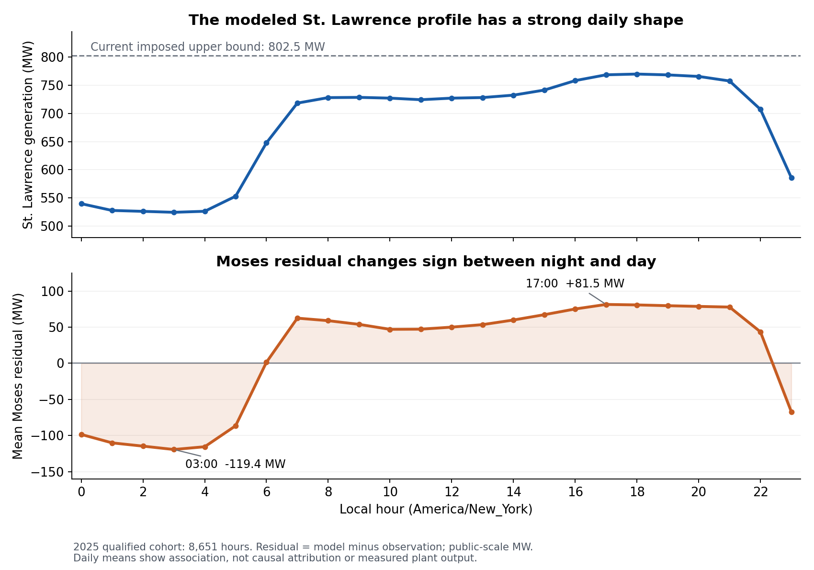

# Moses South: hourly generation and boundary-source diagnosis

Fresh source and accounting checks on October 15, 2026 identify a concrete St. Lawrence reconstruction problem: the model applies an inventory-derived seasonal capability as a hard hourly cap, and imposes a statewide hydro profile without preserving the plant's reported monthly energy. The HQ/PAR sign, timestamp conversion and tested hourly aggregation choices do not explain the large residual. Equivalence between the reduced model's D-area cut and the physical Moses South meter remains unverified.

These findings do **not** identify a unique causal allocation of the Moses error. A St. Lawrence input increase based on the source monthly mean makes the aggregate Moses fit worse when the other inputs are held fixed. Matching both the source energy and Moses observations therefore requires reconciling other net-balance assumptions as well.

## Baseline and accounting contract

The baseline is the corrected 2025 physical-repair model at repository commit `d4aea78c1b042158d7e295edc4cb33cffa5b0341`, not the authors' 2019 model. This investigation addresses the user's current-model question; the separate author-release comparison is unchanged. The baseline annual solutions are reused, with fresh source extraction and diagnostic calculations. **No new AC solve or annual validation is claimed.**

- Physical calendar: 8,760 UTC hours, with local America/New_York labels and both DST folds retained.
- Fixed scoring cohort: 8,651 source-qualified, equation-qualified hours. The original 109 exclusions remain excluded.
- Moses South MAE: **118.820924 public MW**; WAPE: **22.007617%**; mean signed residual: **+12.624497 MW**.
- Residual convention: model minus public observation; Moses positive direction D to E.
- WAPE is `100 * sum(abs(model - observation)) / sum(abs(observation))`, not mean hourly percentage error or the paper's limit-normalized error.

Across the fixed cohort, the independently reconstructed identity closes within `5.684e-12` public MW:

```text
Moses midpoint = St. Lawrence + other native D generation
                 + HQ import + PAR1 import + PAR2 import - gross D load
Primary Moses = midpoint + signed terminal correction
```

All powers above are public-scale MW. The terminal correction is retained from each baseline AC solution in every substitution probe. These probes are accounting sensitivities, not feasible redispatches: statewide balance, reservoir constraints, changed losses and new voltage/reactive behavior are not certified.

The [hourly balance](output/nygrid_2025_moses_source_diagnosis/balance_hourly.csv), [balance contract](output/nygrid_2025_moses_source_diagnosis/balance_contract.json) and [frozen input hashes](output/nygrid_2025_moses_source_diagnosis/source_guard.json) provide the common numerical basis.

## St. Lawrence: a verified reconstruction inconsistency

The modeled plant is EIA plant 2694 at retained bus 48. Its 15 admitted units each contribute 53.5 MW net seasonal capability, giving an imposed 802.5 MW ceiling. Final 2025 EIA-860 agrees with the frozen early-release inventory: this is not a final-versus-preliminary inventory revision. Monthly EIA-860M changes which unit is unavailable—unit 26 in January/February and unit 21 from March onward—but still records 15 operating units each month. Changing those IDs at their common model bus would not change aggregate capacity or Moses flow. Enabling a sixteenth unit for the entire year is not supported by those records.

Final EIA-923 monthly net generation nevertheless implies these mean plant outputs:

| Month | Reported monthly mean, MW | Current imposed ceiling, MW |
|---|---:|---:|
| April | 813.72 | 802.50 |
| May | 844.01 | 802.50 |
| June | 853.13 | 802.50 |
| July | 832.81 | 802.50 |

Even a flat profile at the modeled ceiling cannot produce those reported energies. The conflict is between the adopted hard-cap interpretation and the energy source; it does not establish which equipment availability or capability correction is appropriate. NYPA's public annual generation, 6,730,000 MWh, also agrees with EIA-923's 6,726,939 MWh to within 0.05% at NYPA's reporting precision.

The annual discrepancy is robust to the missing model hours. Keeping all qualified-hour generation and assigning **every one of the 109 excluded hours the full 802.5 MW cap** still leaves at least **772,679.8 MWh (11.49%)** below reported annual EIA generation. The calculation is an upper bound on completing the model year, not a claim that missing hours actually ran at capacity.

The reconstruction uses each monthly plant mean as a prior, clips it to admitted capability, and then projects the hydro fleet onto the statewide NYISO P63 hourly hydro total. At low statewide hydro output it scales plant baselines downward; at high output it distributes generation according to remaining headroom. Because St. Lawrence is already at its imposed ceiling in April–July, high-output hours cannot restore energy lost in low-output hours. Reported plant monthly energy is not an enforced constraint. The subsequent final dispatch adjustment is small relative to this prior construction.

The exact staged decomposition identifies where the qualified-hour St. Lawrence mean is reduced:

| Construction step | Effect on qualified-year plant mean, MW |
|---|---:|
| Nominal versus physical monthly-hour denominator | −0.007 |
| Clip monthly source mean at admitted seasonal capacity | −11.134 |
| Scale down when P63 hydro is below clipped fleet baselines | −82.558 |
| Allocate remaining headroom when P63 hydro is higher | +3.644 |
| Subsequent final dispatch adjustment | +0.386 |
| Total departure from source monthly means on this cohort | **−89.669** |

For example, in June the qualified-hour mean contributions are approximately −50.63 MW from clipping the monthly source mean, −78.76 MW from low-P63-hour scaling, zero recovery in high-P63 hours, and −0.035 MW from final dispatch adjustment. This explains how the reconstruction suppresses St. Lawrence energy; it does not by itself assign the same MW to the Moses observation error.

See the [generation audit](output/nygrid_2025_moses_source_diagnosis/generation/generation_audit_receipt.json), [monthly energy and allocation decomposition](output/nygrid_2025_moses_source_diagnosis/generation/StLawrence_monthly_source_energy_and_allocation.csv), [annual missing-hour bounds](output/nygrid_2025_moses_source_diagnosis/generation/StLawrence_annual_energy_bounds.json) and [conditional generation scores](output/nygrid_2025_moses_source_diagnosis/generation/conditional_generation_scores.csv).

## Hourly shape is influential, but energy correction alone is insufficient

The current St. Lawrence profile averages about 524.6 MW at 03:00 and 768.4 MW at 17:00 local time. Moses mean residual moves from **−119.4 MW at 03:00** to **+81.5 MW at 17:00**. Source/residual correlations share terms in the accounting identity and are not causal estimates.



The following source-defined mean/shape diagnostic recipes hold other D generation, HQ, PAR, load and the baseline terminal correction fixed. No coefficient, offset or lag is fitted to Moses observations. The plan records that preliminary read-only results were already seen; these generation probes are not presented as a prospective validation design.

| Conditional St. Lawrence input | Moses MAE, MW | Mean residual, MW | Interpretation |
|---|---:|---:|---|
| Current profile | 118.821 | +12.624 | Baseline |
| Flat within each month at the current qualified-month mean | 91.869 | +12.624 | Shape-only ablation; preserves modeled qualified-month energy |
| Final EIA monthly mean plus current demeaned hourly shape | 148.614 | +102.294 | Source-mean sensitivity; 4,160 hours exceed current cap |
| Flat within each month at the final EIA mean | 125.184 | +102.294 | Source-mean plus illustrative flat shape; 2,882 hours exceed current cap |

The 26.95 MW MAE decrease in the shape-only ablation establishes sensitivity to the imposed hourly pattern. It is not evidence that the real plant is constant within each month. The available official data provide annual or monthly plant generation, and hourly regional/fuel totals; this audit did not locate verified public 2025 hourly St. Lawrence electrical generation.

The EIA-mean probes deliberately use the full-calendar EIA monthly mean as an assumed mean on the qualified subset. Monthly energy is divided by actual New York physical-month hours, including 743 hours in March and 721 in November. They do not equate the 8,651-hour energy sum with a complete annual source total. Missing-hour bounds and complete-month source comparisons are recorded separately in the generation audit; each month's deficit persists even if all excluded hours are assigned the current 802.5 MW cap.

The energy-only correction adds about 89.67 MW on average to the fixed cohort, leaving a +102.29 MW Moses mean residual. Thus St. Lawrence's energy deficit is a source inconsistency, but the conditional correction requires compensating changes elsewhere in the net balance or comparison boundary to match observations. Candidates include other generation allocation, boundary accounting, load/area scope and the physical observation operator. This investigation cannot identify those offsets uniquely from one net-flow series.

## HQ and PAR: transformations verified; tested alternatives are too small

The current HQ input is the NYIS-reported EIA-930 actual interchange with HQT, negated to make imports positive, with UTC hour ending shifted back one hour to the model's hour-start convention. A fresh reconstruction matches the compiled model within `2.27e-13 MW`. The [EIA-930 instructions](https://www.eia.gov/survey/form/eia_930/instructions.pdf) support the reporting convention.

The two PAR inputs use observed P34 flows, not P53A schedules. The Ontario-to-New-York sign follows the verified NYISO direction diagram effective December 3, 2024. Reconstructing 211,996 native records from 13 ZIP archives—including DST and the endpoint day—reproduces the current forward-weighted hourly inputs within `2.84e-14 MW`.

| Conditional boundary substitution | Moses MAE, MW | Change from baseline, MW |
|---|---:|---:|
| Current inputs | 118.820924 | 0 |
| PAR backward hold | 118.878846 | +0.057922 |
| PAR linear interpolation | 118.813470 | −0.007454 |
| PAR arithmetic sample mean | 118.857459 | +0.036535 |
| Former HQ schedule, including Cedars | 119.995867 | +1.174943 |

These comparisons use the same 8,651 hours. The inspected P34 publication does not settle whether its timestamp labels an instantaneous point or an averaging interval; the alternate conventions remain sensitivity probes. Actual interchange and scheduled delivery are different quantities, so the old schedule is not a substitute observation of actual HQ flow.

Predetermined ±1 physical-hour shifts of HQ, PAR, St. Lawrence, gross D load and the Moses observation all worsen annual MAE on the same 8,480-hour common triplet cohort. HQ, combined PAR and observation shifts worsen every monthly comparison. This rejects a simple one-hour repair among the tested choices; it does not certify every source's subhour measurement semantics.

There are 26 qualified hours with an EIA bilateral-sum versus reported-total discrepancy greater than 2.5 MW. They contribute only **0.2957%** of the annual absolute Moses residual, and excluding them leaves MAE **118.8267 MW**. The inconsistency cannot be attributed specifically to HQ. No independent annual HQT counterpart series was found in the audited public sources.

See the [boundary audit](output/nygrid_2025_moses_source_diagnosis/boundary/boundary_audit_receipt.json), [source-native hourly readback](output/nygrid_2025_moses_source_diagnosis/boundary/hourly_boundary_diagnostics.csv), [probe metrics](output/nygrid_2025_moses_source_diagnosis/boundary/algebraic_probe_metrics.csv) and [timing diagnostics](output/nygrid_2025_moses_source_diagnosis/residual/timing_diagnostics.csv).

## Physical meter and reduced-model boundary remain an open assumption

Independent graph checks confirm that parents 46, 51 and 52 form the current complete AC cut in all four topology states. The former Ontario AC parent 211 is inactive; two prescribed PAR links from bus 100 to bus 48 remain across the broader AC-plus-transfer boundary. HQ enters as a generator proxy at bus 48.

The [official Summer 2025 appendix, page 37](https://www.nyiso.com/documents/20142/3691300/Summer2025-Operating-Study-Appendices-CE-Changes-APPROVED.pdf/c2ba37b6-d7f3-5731-b1d1-84258bea3456) defines seven physical Moses South entries: MSU1, MA1, MA2, Dennison–Norfolk 4, Dennison–Sandstone 5, Alcoa–N. Ogdensburg 13 and Parishville–Colton 3, with specified metered ends. The Winter 2025–26 study replaces MA1/MA2 at Moses 230 kV with HA1/HA2 at Haverstock 345 kV. Posting dates do not establish the operational cutover hour.

There is no verified circuit-to-model mapping or source-backed aggregate-equivalence certificate for those physical terms in the current reduced model. Seven physical entries versus three aggregate branches does not itself prove missing flow: a correct aggregate model could preserve the net boundary. That equivalence, including enclosed injections and metered-end losses, still has to be demonstrated.

Similarly, one NYIS–HQT interchange value assigned to bus 48 does not separately resolve Chateauguay/Massena, Cedars/Dennison or wheeling. The [Summer 2025 main study, page 19](https://www.nyiso.com/documents/20142/3691300/Summer2025-OperatingStudy-APPROVED.pdf/3aaa5eb6-9fa4-53b5-181a-189e3ac52fcb) distinguishes those paths and NYCA delivery from total flow. Its transfer limits are not hourly telemetry and cannot supply an invented correction. The unresolved scope issue is plausible, but no causal MW estimate is established here.

The [physical boundary review](output/nygrid_2025_moses_source_diagnosis/physical_boundary/physical_boundary_review.json) retains all three seasonal definitions separately and leaves unknown terms unresolved.

## Supported next modeling step

Rebuild the native hydro allocation with explicit plant monthly-energy accounting and a source-supported hourly capability/availability policy. First reconcile the reporting scope and net/gross measurement basis of plant EIA energy and statewide P63 hydro totals before treating both as exact constraints. The current capacity assumption makes some monthly targets infeasible, so merely imposing EIA energy on the existing bounds will fail. Dated capability evidence is needed to resolve that conflict; seasonal ratings and nameplates are not interchangeable.

In parallel, certify the physical Moses boundary and split/locate HQ and Cedars consistently with it. This is necessary to determine whether the compensating net-balance discrepancy belongs to other D generation or to the comparison boundary. Obtain actual hourly St. Lawrence generation if available from the operator; a residual-implied plant series must not be used as source data.

The current model, interactive map, handoff archive and default inputs remain unchanged. These are diagnostic artifacts, not a promoted repaired model or an improved annual-validation claim.

## Reproduction and evidence preservation

Run from the repository root with Python, NumPy, pandas, SciPy and matplotlib available. The main generation audit uses the committed authenticated plant extract and does not require the national workbook caches. Re-extracting the inventory with `generation/fetch_inventory_evidence.py` additionally requires openpyxl.

```powershell
cd "C:\Users\Holiday\Desktop\npcc_ny_lite_package_fixed\WECC and NPCC Systems"
python scripts/nygrid_2025_moses_source_diagnosis/prepare_balance.py
python scripts/nygrid_2025_moses_source_diagnosis/audit_physical_boundary.py
python scripts/nygrid_2025_moses_source_diagnosis/generation/audit_stlawrence.py
python scripts/nygrid_2025_moses_source_diagnosis/boundary/audit_sources.py
python scripts/nygrid_2025_moses_source_diagnosis/residual/analyze_temporal.py
python scripts/nygrid_2025_moses_source_diagnosis/residual/analyze_components.py
python scripts/nygrid_2025_moses_source_diagnosis/residual/review_source_alternatives.py
python scripts/nygrid_2025_moses_source_diagnosis/build_figures.py
python scripts/nygrid_2025_moses_source_diagnosis/validate_delivery.py
```

The national EIA-860/860M XLSX and ZIP downloads remain preserved locally. Git contains the selected source rows, URL/hash receipts and retrieval script rather than approximately 190 MB of national inventory caches. Retrieval must match the recorded hashes; a changed upstream vintage is a new source, not permission to overwrite this evidence. Existing model/source inputs are guarded by SHA-256. New artifacts are confined to the diagnostic namespace and this report.
