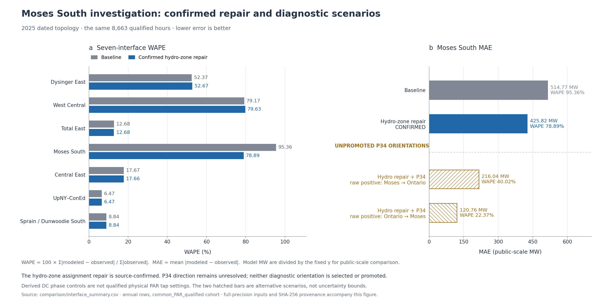

# Moses South: 2025 diagnosis and source-backed hydro allocation correction

The versioned correction moves 26 hydro plants from the incorrect county-based
Zone D assignment to their explicitly reported Zone E sites. The confirmed
148-bus repair reduces Moses South WAPE from **95.36% to 78.89%**, and mean
absolute error from **514.77 to 425.82 public-equivalent MW**, over the same
8,663 qualified 2025 hours. The remaining error is substantial.

Use [npcc_nygrid_2025_moses_corrected_dc.m](System%20Matpower%20Format/npcc_nygrid_2025_moses_corrected_dc.m)
for this corrected research case. It retains the 148-bus topology, all original
NPCC buses, the eight added stations, and the frozen per-unit dispatch, capacity
bounds, demand, four DC schedules, and aggregate external exchanges. The older
inputs, builders, cases and comparison results are preserved byte-for-byte.

## Confirmed generation allocation defect and correction

The generic county rule put all the affected St. Lawrence County sites in D.
The preserved **2025 NYISO Gold Book, Table III-2a**, explicitly puts these
particular plants in E. The correction uses a curated plant/site crosswalk,
with unique EIA plant identities, names/aliases, counties, watercourses and
Gold Book station/PTID evidence. It does not reassign the entire county.
Allens Falls and Parishville, for example, remain in D.

The 26 sites cover **55 inventory rows, including 46 admitted generator rows**.
Their mean dispatched output is **94.565 MW** on the common 8,663-hour cohort.
The existing within-zone nearest-original-bus policy assigns their corrected
landings to **bus 46, Colton, or bus 47, Moses W**. These remain coarse model
landings, rather than certified physical interconnection substations.

Only six location/mapping fields change, across 330 cells. Generator identities,
admission, availability, capability, preferred output and final output do not
change. The bounded dispatch objective, generator boxes and statewide balance
target are independent of generator bus IDs; the same unit dispatch therefore
remains the original optimum after this location correction. Every corrected
case is then solved again on the network.

Evidence: [26-plant source crosswalk](output/nygrid_2025_moses_audit/generation/confirmed_hydro_zone_corrections.csv),
[Gold Book evidence rows](output/nygrid_2025_moses_audit/generation/goldbook_zone_evidence.csv),
[exact field changes](output/nygrid_2025_moses_audit/corrected/fleet/changed_fields.csv),
[repair receipt](output/nygrid_2025_moses_audit/corrected/fleet/repair_receipt.json),
and [independent source/code review](output/nygrid_2025_moses_audit/mapping/generation_and_dc_control_review.json).

## Rerun of all seven interfaces

These are post-hoc comparisons against the same NYISO observations, using the
dated topology and the same 8,663 hours. WAPE is
`100 * sum(abs(predicted-observed)) / sum(abs(observed))`. MW values below
divide model MW by the unchanged `gamma = 0.30012075175285535`.

| Interface | Before WAPE | Corrected WAPE | Before MAE, MW | Corrected MAE, MW |
|---|---:|---:|---:|---:|
| Dysinger East | 52.37% | 52.67% | 439.38 | 441.90 |
| West Central | 79.17% | 79.63% | 441.14 | 443.72 |
| Total East | 12.68% | 12.68% | 397.07 | 397.00 |
| Moses South | 95.36% | **78.89%** | 514.77 | **425.82** |
| Central East | 17.67% | 17.66% | 294.10 | 293.98 |
| UpNY–ConEd | 6.47% | 6.47% | 193.84 | 193.84 |
| Sprain/Dunwoodie South | 8.84% | 8.84% | 163.31 | 163.31 |

The source correction is retained because its site assignment is confirmed,
including the small regressions in the western gates. Internal interface
observations were not used to choose plants, bus landings or dispatch.

Both dated and fixed year-end cases were replayed. Their Moses results agree;
the year-end Dunwoodie result remains 8.96% WAPE. The same 97 source-gap hours
remain unavailable. [All annual comparisons](output/nygrid_2025_moses_audit/comparison/interface_summary.csv)
and [monthly comparisons](output/nygrid_2025_moses_audit/comparison/interface_monthly.csv)
include every interface, cohort and diagnostic variant.



[Exportable PDF](output/nygrid_2025_moses_audit/figures/moses_repair_and_diagnostics.pdf)
and [SVG](output/nygrid_2025_moses_audit/figures/moses_repair_and_diagnostics.svg).
The [historical-context figure](output/nygrid_2025_moses_audit/figures/moses_historical_context.png)
separates the larger 2025 absolute error from its smaller observed-flow denominator.

## Main remaining lead: Ontario transfer routing and St. Lawrence PAR control

The model has an exact lossless Zone D balance:

`Moses South = generation in D - demand in D + Ontario-to-D flow`.

Generation in this identity includes the signed HQ/Cedars equivalent once.
The single retained Ontario–Moses equivalent is original branch 211,
**48 (Moses E) → 100 (PHAS)**. Its original phase shift is fixed at zero.
The legacy reconstruction supplies total Ontario exchange but does not supply
hourly St. Lawrence phase-angle-regulator (PAR) control.

| Mean public MW, old 140-bus reconstruction | 2019 | 2025 |
|---|---:|---:|
| Total Ontario export into NY | 718.08 | 760.39 |
| Modeled northern delivery into D | 27.93 | 420.31 |
| Modeled western delivery into A | 690.16 | 340.08 |

Thus total Ontario exchange rises only **42.31 MW**, while modeled northern
delivery rises **392.38 MW** and western delivery falls **350.07 MW**. This
is consistent with the opposing 2025 Moses and western signed biases.
The [linear injection decomposition](output/nygrid_2025_moses_audit/exchanges/ontario_northern_flow_injection_decomposition.csv)
reproduces that routing change, including changes in signed DC injections.
It explains the model's arithmetic, rather than identifying a unique physical
cause from internal observations.

Official IESO documentation identifies the two St. Lawrence connections as
PAR-controlled and reports PAR replacement in 2022–2023 after a 2018 failure.
The public NYISO P-34 series for **PS33/PS34, PTIDs 25118/25119**, independently
show a much smaller 2025 transfer magnitude than the uncontrolled model.
On the current dispatch cohort their original-sign combined mean is
**24.352 MW**. The source has 8,673 qualified physical hours, including every
one of the 8,663 dispatch-qualified hours, with 87 unfilled source gaps.

Sources: [IESO 2024 transmission-interface overview, section 2.2.5](https://www.ieso.ca/-/media/Files/IESO/Document-Library/planning-forecasts/apo/Mar2024/Ontario-Transmission-Interfaces-and-Interties-Overview.ashx),
[NYISO P-34 archive](https://mis.nyiso.com/public/P-34list.htm),
[download receipts](output/nygrid_2025_moses_audit/exchanges/par_source_receipts.csv),
and [qualified PAR hourly data](output/nygrid_2025_moses_audit/exchanges/par_stlawrence_hourly_2025.csv).

### PAR diagnostics are not promoted corrections

The inspected public text does not establish P-34's positive geographic
direction for these two PTIDs. NYISO's December 2014 diagram explicitly marks
a sign-convention change, but its arrows could not be inspected: direct
official documents returned a JavaScript verification page, and mirrored PDF
downloads returned HTTP 403. Endpoint-name order and better Moses agreement
are not sufficient evidence to select the sign.

Both fixed source orientations were therefore run as **unpromoted diagnostics**
after the confirmed hydro correction. The controller imposes the independent
external transfer while preserving generation, demand, branch R/X, topology and
total Ontario exchange. It does not impose a Moses South observation.

| Dated Moses South variant | MAE, public MW | Bias, public MW | WAPE |
|---|---:|---:|---:|
| Frozen baseline, replayed | 514.77 | +513.33 | 95.36% |
| Confirmed hydro-zone correction | 425.82 | +422.24 | 78.89% |
| Hydro correction + raw PAR positive from Moses | 216.04 | −27.13 | 40.02% |
| Hydro correction + raw PAR positive toward Moses | 120.76 | +21.57 | 22.37% |

The direction is not chosen using these scores. Both diagnostics strengthen
the missing-control/routing explanation, but neither is an accepted replacement
for the source-qualified case. The computed aggregate-equivalent shifts reach
approximately **−100° to +32°** across the diagnostics. They are mathematical
DC offsets, not measured or hardware-qualified physical PAR tap settings.
Physical meter-to-equivalent coverage, phase limits and AC feasibility remain
unverified even after a documentary sign is available.

A constant-zero substitute was also rejected. The official January 2025
P-53A schedules contain nonzero ±25 MW values in 1,026 of 1,488 PS33/PS34
unit-hours. No constant target was inferred from a planning-study table.
[Sign audit](output/nygrid_2025_moses_audit/mapping/p34_sign_source_audit.json)
and [external audit](output/nygrid_2025_moses_audit/exchanges/exchange_audit_summary.json)
preserve the unresolved evidence and source checks.

## Other hypotheses checked

- **St. Lawrence duplication:** US EIA plant 2694 and its admitted units are
  counted once. Hydro plant-to-unit allocation conserves MW; no duplicate
  plant-month or nonfossil unit identities were found. The bounded projection
  changes Zone D hydro by less than 1 MW on average. Monthly hydro energy is
  still an allocation prior, not independently observed hourly net dispatch.
- **HQ sign or double counting:** Negative HQ exchange is preserved through
  final PG and signed bounds. HQ-NY includes wheel-through; HQ_IMPORT_EXPORT
  overlaps it and excludes those wheels. Official Gold Book annual totals
  corroborate using HQ-NY plus the separate Cedars channel once. Replacing or
  adding HQ_IMPORT_EXPORT would introduce an accounting error.
- **Other external schedules:** Regional generation minus regional demand
  matches each prescribed aggregate exchange; all four DC signs are retained.
- **Observation/index/timing error:** The original NYISO monthly ZIPs reproduce
  Moses South observations at stable point 23319. Corrected full-network rows
  −46, −51 and −52 and the 148-bus recovery agree. An alternate hourly average
  changes WAPE by only 0.00228 percentage points. No interface operator was
  changed. Official physical 2025 flowgate membership remains uncertified.

Evidence: [generation audit](output/nygrid_2025_moses_audit/generation/generation_audit_summary.json),
[regional balance](output/nygrid_2025_moses_audit/balance/balance_validation.json),
and [74-check mapping/source audit](output/nygrid_2025_moses_audit/mapping/summary.json).

## Use, evidence and remaining qualification

```matlab
addpath('System Matpower Format');
mpc = npcc_nygrid_2025_moses_corrected_dc(1);
[result, success] = rundcpf(mpc, mpoption('verbose', 0, 'out.all', 0));
assert(success);
interfaces = npcc_nygrid_2025_slim_interfaces(result);
```

The default loader accepts only the confirmed hydro repair. It rejects source
gaps and unpromoted PAR variants. Pass `'hydro_zone_corrected','year_end'` as
the second and third arguments for the fixed year-end network.

The [reproduction README](scripts/nygrid_2025_moses_audit/README.md) gives the
commands and input contracts. [Annual validation](output/nygrid_2025_moses_audit/validation/annual_validation.json),
[MATPOWER validation](output/nygrid_2025_moses_audit/validation/matlab_validation.json),
and [delivery manifest](output/nygrid_2025_moses_audit/delivery_manifest.json)
record the final checks and exact artifacts.

All eight annual variants were freshly solved, totaling **69,304 qualified
variant-hours**. The independent annual gate passes **5,697 checks**, including
all-hour branch equations and nodal balance, lifted 191-bus recovery, the
unchanged generator boxes and dispatch KKT conditions, all 112 annual score
rows, and all 1,344 monthly score rows. Its 32 representative bordered-system
re-solves do not import the production solver. **48 fresh MATPOWER snapshots**
also pass: 20 confirmed hydro-repair cases and 28 separately labeled PAR
diagnostics across both topology variants. Maximum branch and interface
differences are respectively 3.12e-11 and 4.14e-11 model MW. Source-gap and
unsupported-control requests are rejected. These are numerical consistency
checks; they do not resolve the physical PAR direction or operating limits.

This remains a DC research reconstruction. The confirmed hydro location fix is
usable within that scope. The large residual error is not closed, and the PAR
diagnostics are not promoted to physical operating-model evidence.
