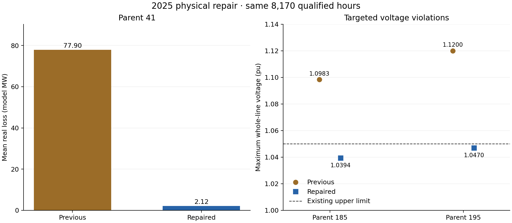

# Physical repair of parents 41, 185 and 195

Completed annual replay of the frozen `physical_repair_41_185_195_20261015` candidate, based on repository commit 6d46babc3af4335638241e3abff525425a0a6d7e. The requested physical defects are evaluated below using fresh solves and independent reconstruction. The previous model, annual results and pre-existing map work have recoverable preserved copies.

## Result

The repaired model qualifies **8,651 of 8,651 source-qualified hours**, retaining all 8,760 clock rows and the 109 source-excluded positions. There are **481 newly qualified hours** and **0 previously qualified hours lost**. The comparison cohort contains 8,170 identical hours. The solver used 148 retained voltage buses, preserved all 1,464 generator rows and six prescribed transfers, and did not fit observed interface flows.

On that paired cohort, parent 41 mean loss falls from **77.89670 to 2.12032 model MW**, a **97.278% reduction**. On all 8,651 new qualified hours, its mean loss is 2.36498 model MW. Its preserved aggregate 2,000 A apparatus ceiling is exceeded in 2,722 hours; the loss repair does not certify equipment or weather-dependent DLR adequacy.

| Repaired parent | Minimum whole-line voltage | Maximum whole-line voltage | Hours outside 0.95–1.05 pu |
|---|---:|---:|---:|
|185|1.020000|1.039380|0|
|195|1.006570|1.046992|0|

The voltage table uses all 8,651 qualified hours, including newly successful hours. The figure uses the paired cohort for direct before/after comparison.

## What changed

**Parent 41:** restore the imported R/X = 0.0018/0.0089 pu on 100 MVA. Rebuild the conductor realization from the already-declared inverse search's first-ranked imported-R/X candidate: ACSS Mallard, four uncoupled parallel circuits, one conductor per phase, 10.750872722 km effective length, GMD 3.948477 m, 95°C reference resistance. The corresponding geometric B is 0.021267472267637012 pu. Electrical/thermal metadata and current registry provenance are updated together. The prior aggregate 2,000 A terminal apparatus ceiling is retained as an independent conservative bound. Approximate map geography is not used to force the electrical length, and no installed-line identity is claimed.

**Parents 185/195:** retain current conductors, section R/X/B and the existing 75% nominal shunt-compensation rating. Remove the old endpoint-only reactor allocation and distribute it in proportion to local charging: each section contributes `0.75 × baseMVA × B_section /2` MVAr at 1 pu to each endpoint. The total nominal reactor rating does not increase. Interior shunts remain passive admittances, so the same exact complex-network reduction and current recovery apply. These intermediate reactors are a declared synthetic design, not a claim about installed substations.

The source profiles, hourly native/HQ active generation, regional interchange targets, six DC/PAR targets, voltage limits, generator voltage setpoints and bus/branch/generator axes remain unchanged.

## Annual interface comparison

Mean absolute errors below are public-scale MW on the same 8,170 hours, using the frozen signed original-from-terminal convention. WAPE uses total absolute observed flow as its denominator. Physical repairs are assessed independently of improvements or regressions in interface fit.

| Interface | Previous MAE | Repaired MAE | Previous WAPE | Repaired WAPE |
|---|---:|---:|---:|---:|
| DYSINGER EAST | 258.64 | 258.64 | 29.96% | 29.96% |
| WEST CENTRAL | 255.04 | 255.04 | 45.86% | 45.86% |
| TOTAL EAST | 472.69 | 471.79 | 14.70% | 14.67% |
| MOSES SOUTH | 120.78 | 120.78 | 22.94% | 22.94% |
| CENTRAL EAST - VC | 233.06 | 233.68 | 13.70% | 13.74% |
| UPNY CONED | 224.33 | 224.33 | 7.56% | 7.56% |
| SPR/DUN-SOUTH | 168.42 | 168.42 | 9.18% | 9.18% |

The full scoring output separately reports all newly qualified hours, the common cohort, any lost hours, each calendar month, post-Dover hours, and alternate terminal conventions. Physical 2025 P32 meter membership and the inherited numeric-as-MW interpretation of the source `Flow(MWH)` header remain unverified. Oracle adjustments were not used as generation inputs.

## Remaining operating limitations

The requested parent 185/195 voltage issue is evaluated explicitly; whole-network operating qualification remains **0 hours**. Elsewhere the annual readback finds 8,651 hours with overvoltage, 599 with undervoltage, 8,651 with generator-Q violations, 8,651 with assumed generator-S violations, and 4,794 with branch-MVA violations. The overall voltage range is 0.841226–1.076170 pu. These violations remain visible in the map/package; equation qualification is not an operating certificate.

The model is usable as a reproducible synthetic research model with the stated limits. It is not a validated historical dispatch, installed-asset model, or new annual weather/thermal simulation. No voltage value was clipped and no voltage, reactive or apparatus threshold was relaxed to obtain a pass.

## Verification and delivery

The targeted preflight passed 17 hours across all four topology states, matched parent 41 forward R/X/B to 1.74e−18 pu and detailed/compact voltages to 1.17e−12 pu. The full-year checks independently reconstruct the source inputs, finite P/Q/assumed-S capabilities, active/reactive nodal equations, branch complex powers and terminal currents, material I²R losses, passive voltage recovery, and zonal/regional loss accounting. Failed or source-excluded rows are never rendered as valid predictions.

- [Annual producer receipt](output/nygrid_2025_physical_repair/annual/physical_repair_v1/annual_receipt.json)
- [Independent input/accounting review](output/nygrid_2025_physical_repair/annual/physical_repair_v1/validation/annual_input_accounting_review.json)
- [Independent physical review](output/nygrid_2025_physical_repair/independent/annual_physics_review.json)
- [Scoring receipt](output/nygrid_2025_physical_repair/annual/physical_repair_v1/comparison/scoring_receipt.json)
- [Target-parent comparison table](output/nygrid_2025_physical_repair/independent/target_parent_metrics.csv)
- [Reproduction instructions](scripts/nygrid_2025_physical_repair/README.md)

The updated interactive map and portable handoff use the newly compiled corrected templates and this completed annual replay. Their individual delivery manifests bind the model, source profiles, annual arrays, interface definitions, geography, runtime, documentation and offline assets. Old numerical bundles remain preserved for reproducing prior reports.
