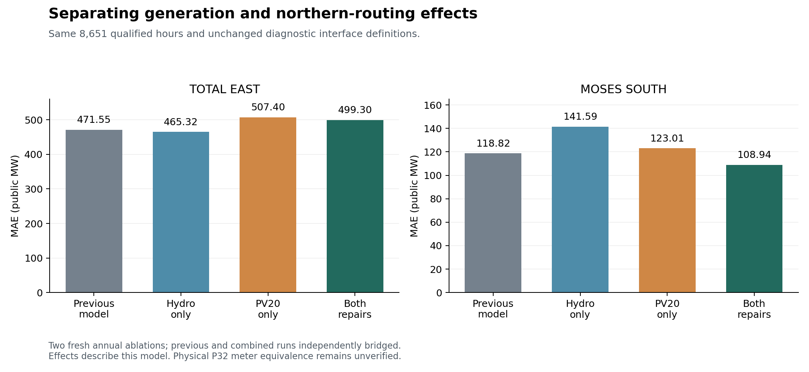

# Total East regression, remaining Moses South error, and generation data

The controlled runs identify **PV20 routing as the main cause of the Total East error increase inside the current model**. The St. Lawrence repair partly offsets that effect. The strongest newly identified remaining northern input error is **Zone D wind energy overallocation**: the modeled qualified-hour subset already exceeds the six matched plants' reported full-year energy by 237.7 GWh. St. Lawrence's reconstructed hourly shape remains influential, but it cannot alone reconcile the remaining monthly balances under the current boundary assumptions.

NYISO does publish generation data: public real-time output by statewide fuel category, plus named-resource/fleet annual net energy and capability in the Gold Book. Those products do not supply a public, named hourly St. Lawrence output series. The data distinctions and verified official links appear below.

This is an additive investigation of the model committed as `30904058a6c2acac4fffa85a2d15a90e396c3681`. The current model, map, handoff archive and pointer are unchanged. All numerical powers below use public MW, except where MWh/GWh or model-scale physics residuals are explicitly stated. Comparisons use the same 8,651 source-qualified hours; all 8,760 clock positions and 109 exclusions remain available in the evidence.

## 1. Why Total East became worse

Two fresh annual ablations separate the joint repair. B is the previous physical-repair model; G applies the corrected hydro allocation, dated admission and capability bounds; P applies PV20 routing and the corresponding ISO-NE pool adjustment; GP is the released combined repair. The B and GP scenario construction was independently bridged to the saved annual cases at 12 source-selected monthly hours. Both new G/P runs qualify all 8,651 hours with zero exceptions. Independent branch-law, nodal-balance, input and regional-accounting checks pass.

| Same-cohort MAE, public MW | B: previous | G: hydro only | P: PV20 only | GP: both |
|---|---:|---:|---:|---:|
| Total East | 471.551 | 465.320 | 507.402 | 499.304 |
| Moses South | 118.821 | 141.586 | 123.015 | 108.945 |

PV20 rerouting moves the signed northern component out of the main New York eastbound path while preserving total ISO-NE interchange. Its order-averaged signed-flow effect on Total East is **−71.792 MW**. The hydro change has an opposing **+17.421 MW** effect. Together, average predicted Total East flow falls **54.372 MW**, deepening an existing underprediction: signed bias changes **−285.786 → −340.157 MW**.

The MAE decomposition averages each change's marginal effect with and without the other change (a two-factor Shapley decomposition). PV20 contributes **+34.917 MW** to MAE, hydro contributes **−7.165 MW**, and their sum is the observed **+27.753 MW** regression. The explicit interaction contrast is **−1.867 MW**; it is already shared by those order-averaged effects and must not be added again. These are controlled effects in this model, not estimates of real-world source errors.

The current proxies impose the exact identity `Total East = Central East + parent224`. The four shared corridor terms fall by **45.419 MW** and the parent224 term by **8.953 MW**. Central East was overpredicted, so its reduction helps; Total East was underpredicted, so its reduction hurts. The same physical-model change can therefore improve one diagnostic and worsen the other. In 5,659 hours, a lower prediction deepens a previous Total East underprediction; that group contributes +40.899 MW to annual MAE, partly offset by improvements elsewhere.

Sources and reproducible calculations: [factorial definitions and commands](scripts/nygrid_2025_postrepair_diagnosis/ablations/README.md), [scenario metrics](output/nygrid_2025_postrepair_diagnosis/ablations/factorial_metrics.csv), [effect decomposition](output/nygrid_2025_postrepair_diagnosis/ablations/factorial_attribution.csv), [proxy identity](output/nygrid_2025_postrepair_diagnosis/TotalEast_CentralEast_proxy_identity.csv), and [absolute-error partition](output/nygrid_2025_postrepair_diagnosis/TotalEast_absolute_error_change_partition.csv).

## 2. The Total East measurement definition also needs work

NYISO's Summer 2025 operating-study definition contains 29 Total East entries, including PV20 and additional PJM/New York paths. The current legacy proxy contains five parent terms. Central East also includes PV20 in the source definition, while its current four-parent proxy omits an explicit PV20 term. Adding one missing term does not establish the entire physical operator, its terminal signs, or the P32 `CENTRAL EAST - VC` telemetry expression.

Using the source-directed outward PV20 sign, `export = −adopted import`, adds 75.989 MW on average to either legacy proxy. On the repaired model, this one-term accounting sensitivity changes Total East MAE **499.304 → 463.439 MW**, but changes Central East MAE **208.719 → 248.059 MW**. The sign is taken from the source direction, not selected for a lower score.

That apparent Total East improvement is not a certified repair of its comparison. Adding the same reported PV20 proxy to the old legacy readout gives 441.217 MW MAE, so the numerical difference between these two augmented readouts still worsens by 22.223 MW. The old-model augmentation is itself a hybrid diagnostic: the old model did not route PV20 separately. Neither mixed-scope comparison nor one added term can certify a complete physical Total East operator. The observed Total-East-minus-Central-East mean is 1,463.677 MW, while the repaired parent224 proxy is 1,010.905 MW; the 452.772 MW gap is a limitation of the imposed proxy relationship, not proof of that amount of error on one physical line.

The public P34 values used for PV20 are operator-reported numbers under the inherited MW/forward-hold interpretation. The native `Flow(MWH)` header, exact instantaneous-versus-interval support and metered-versus-calculated publication origin are not independently resolved by the inspected documentation. An official January 2026 PAR diagram corroborates the later diagram's Sand Bar direction, but does not establish a 2025 effective certificate. These qualifications refine the earlier shorthand description of the series as an observed meter flow.

See [readout sensitivities](output/nygrid_2025_postrepair_diagnosis/boundary/readout_sensitivity_metrics.csv), [boundary readout receipt](output/nygrid_2025_postrepair_diagnosis/boundary/boundary_readout_receipt.json), and [source semantics review](output/nygrid_2025_postrepair_diagnosis/boundary/source_semantics_review.json). The underlying physical definitions are in the [official Summer 2025 appendix](https://www.nyiso.com/documents/20142/3691300/Summer2025-Operating-Study-Appendices-CE-Changes-APPROVED.pdf/c2ba37b6-d7f3-5731-b1d1-84258bea3456).

## 3. What remains wrong in the Moses South inputs

### A. The Zone D wind allocation contradicts independent annual energy

The six modeled Zone D wind plants are Clinton, Ellenburg, Marble River, Altona, Chateaugay and Jericho Rise. Their identities, NYIS balancing-area membership and northern-zone mappings are checked against source records. Final EIA-923 reports **1,425,010 MWh** for their combined 2025 net generation. The current model assigns **1,662,733.25 MWh in the 8,651 qualified hours alone**.

The known subset already exceeds the entire reported year by **237,723.25 MWh**. Filling the excluded hours with zero cannot remove that excess. Under the model's nonnegative wind-generation assumption, at least **27.479 MW of mean qualified-hour wind generation must be removed from Zone D** to meet that annual source total. This energy inequality does not depend on a guessed profile for excluded hours, but it is conditional on those nonnegative bounds. EIA permits negative net generation when station service exceeds gross output. Reconciling the entire excess through the 109 excluded hours alone would require approximately **−2,181 MW of average net generation across the six plants**; no actual auxiliary-consumption bound is invented here. The separate full-calendar diagnostic estimate is 1,683,963.65 MWh, or 18.17% above EIA, but its latent-hour assumptions are not used for the conditional lower bound.

The mechanism is traceable: the existing wind prior applies an identical statewide capacity factor across sites, allocating the statewide wind signal by admitted nameplate shares. Plant-specific annual energy, weather and curtailment differences are not enforced. That policy appears in [generation_priors.py](scripts/nygrid_2025_inputs/generation_priors.py) and [build_compact_nonfossil_generation_inputs.py](build_compact_nonfossil_generation_inputs.py); the source review records exact line references.

On the current complete modeled northern cut, removing 27.479 MW of Zone D wind reduces mean Moses flow by the same amount before changed terminal losses. Holding other inputs and the saved terminal correction fixed, current bias **+24.320 MW** would become at most **−3.160 MW**. This makes wind overallocation a strong input-error explanation for the remaining positive mean bias. It does not prove the remaining hourly MAE would disappear, identify a correct hourly wind profile, or validate the physical meter mapping. A future correction must redistribute wind consistently with the statewide target and validate the resulting AC cases.

Four wind plants carry raw EIA respondent code AM; Marble River and Jericho Rise carry M. AM must not be conflated with the annual-only A category: technical metadata describes AM as monthly values reported once per year, while A has estimated monthly allocations. EIA's own Schedule 3D instructions require annual wind respondents to report each month's operational data. The annual energy finding does not rely on that monthly classification. Matched non-St. Lawrence Zone D hydro has a much smaller annual deficit of approximately 16.9 GWh, about 1.93 MW of annual mean, with one unmatched small hydro plant; that opposite-sign mean discrepancy does not explain the wind excess. See the [EIA-923 instructions](https://www.eia.gov/survey/form/eia_923/instructions.pdf) and [PUDL respondent-code documentation](https://docs.catalyst.coop/pudl/en/v2026.2.0/_modules/pudl/metadata/codes.html).

See [wind source-energy review](output/nygrid_2025_postrepair_diagnosis/generation/D_wind_source_energy_review.json), [wind identity crosswalk](output/nygrid_2025_postrepair_diagnosis/generation/D_wind_asset_source_crosswalk.csv), [annual plant comparison](output/nygrid_2025_postrepair_diagnosis/generation/D_wind_annual_EIA_comparison.csv), and [other hydro review](output/nygrid_2025_postrepair_diagnosis/generation/D_HY_source_energy_review.json).

### B. St. Lawrence's hourly reconstruction remains influential

The repaired St. Lawrence profile still has a strong daily shape: qualified-hour means are 647.5 MW at 03:00 and 833.4 MW at 17:00 local time. Moses residual means are **−75.2 MW at 03:00** and **+61.6 MW at 17:00**. The 855 MW engineering ceiling binds in 3,161 qualified hours. These associations are not independent causal measurements.

A source-defined minimum-variance/monthly-flat control preserves every monthly EIA energy total, the reconciled hourly HY total, unit availability and capability constraints, and uses the existing donor projection. It is not fitted to P32. Replacing the full native-D injection change—including other HY redistribution—in the saved balance reduces conditional MAE **108.945 → 90.187 MW**, with bias **24.320 → 24.821 MW**. This annual number holds the original terminal correction fixed; it is not a new annual AC validation or a recommended dispatch.

Twelve source-selected extreme-change AC pairs all pass equation/loss/recovery checks. Their flow changes reconcile to native-D input change plus changed terminal loss within 3.87e-12 MW; terminal corrections change by up to 8.374 MW on that selected subset. The checks support the mechanism, but their subset scores must not be generalized to the year.

An additional necessary-condition test rules out a St. Lawrence-only explanation under the current other inputs, boundary operator and saved terminal corrections. Residual-implied St. Lawrence generation is incompatible with reported monthly energy in **all 12 months**, even allowing every excluded hour to generate anywhere from zero to 912 MW (the full 16-unit nameplate sensitivity, not certified capability). For example, May would require 67,322 MWh in 15 excluded hours, versus 13,680 MWh at 912 MW. Other net-balance terms or the observation mapping must also change under these assumptions. The oracle is never used as a source or dispatch target.

See [daily patterns](output/nygrid_2025_postrepair_diagnosis/daily_profiles.csv), [shape-control policy](output/nygrid_2025_postrepair_diagnosis/generation/monthly_flat_shape_policy.json), [conditional annual shape scores](output/nygrid_2025_postrepair_diagnosis/monthly_flat_frozen_terminal_scores.csv), [12-pair AC review](output/nygrid_2025_postrepair_diagnosis/generation/shape_ac/monthly_flat_AC_receipt.json), and [monthly energy compatibility](output/nygrid_2025_postrepair_diagnosis/conditional_StLawrence_only_energy_compatibility.csv).

### C. Boundary and meter uncertainties still matter

The model's northern midpoint balance is exact: native D generation plus HQ, Ontario PARs and PV20 proxy imports, minus gross D load. The primary reading adds the signed terminal correction. Changing impedances cannot independently change that fixed-input net balance. Switching to the modeled north-side terminal raises mean flow by 22.621 MW and worsens MAE to 112.948 MW; a terminal switch is not a supported fix for the remaining error.

Sand Bar and Plattsburgh are different meter locations. South Hero net load and intervening losses would normally make Plattsburgh import smaller than the Sand Bar reading, affecting the sign of the current positive bias. But the documented 6.66 MVA peak of one feeder is not a complete hourly tap-load or meter-error bound. HQ remains an aggregate regional input, and the physical Moses/P32 terminal/cutover correspondence is incomplete. These unresolved terms cannot be assigned causal MW from one scalar residual.

The combined Moses gain also contains compensating effects: G-only bias is +101.664 MW, P-only bias is −64.917 MW, and combined bias is +24.320 MW. Each single change worsens MAE relative to B, while the combination improves it. The MAE interaction is −36.835 MW, but mean prediction interaction is only +0.198 MW; most of the large MAE interaction reflects the absolute-error metric and offsetting signed changes, not large electrical nonlinearity. Source consistency should determine corrections, not whichever single variant happens to fit P32 best.

## 4. What generation data NYISO publishes

| Public product | What it provides | What it can validate |
|---|---|---|
| [P63 Real-Time Fuel Mix](https://mis.nyiso.com/public/P-63list.htm) | Statewide generation by fuel; nominal five-minute observations, daily CSV and monthly ZIP history including all 2025 | Statewide Hydro/Wind/etc. totals. No plant-name or PTID field. This is already the aggregate source in the model. |
| [Gold Book](https://www.nyiso.com/documents/20142/2226333/2025-Gold-Book-Public.pdf) | Named resources/fleets, inventory, seasonal capability, prior-year annual net energy; annual zonal/type energy tables | Annual resource/fleet totals and capacity context. Verified 2025 edition lists St. Lawrence FDR fleet PTID23600 with 2024 net energy 7,355 GWh, not 2025 hourly output. |
| [P27 delayed bid data](https://mis.nyiso.com/public/P-27list.htm) | Generator/bidder identities are masked; three-month publication lag; offers and commitment parameters | Bid behavior, not named actual plant dispatch. `Dispatch MW(1–12)` are bid-curve fields. |
| [P19 generator names](https://mis.nyiso.com/public/P-19list.htm) and [generator LBMP](https://mis.nyiso.com/public/P-4Blist.htm) | Identity/zone/PTID reference and named-node prices | Identity or price validation, not electrical MW output. |

The [official bid-release description](https://mis.nyiso.com/public/postings/NYISO%203%20Month%20Bid%20Data%20Release%20Description_V1.pdf) explains masking and bid fields. NYISO's [Day-Ahead Scheduling Manual](https://www.nyiso.com/documents/20142/2923301/dayahd_schd_mnl.pdf/0024bc71-4dd9-fa80-a816-f9f3e26ea53a) classifies participant resource/bid/posted-schedule access as private to entitled users; schedules are not themselves proof of metered output.

The official Gold Book catalog was found, but the exact 2026 edition's file/content could not be verified through the public listing during this bounded search. No claim that the 2026 book is absent is made. Keep publication year and generation year separate. The [11-product catalog](output/nygrid_2025_postrepair_diagnosis/generation/generation_data_availability.csv) and [generation source review](output/nygrid_2025_postrepair_diagnosis/generation/generation_source_review.json) retain schemas, source URLs, access and temporal qualifications. EIA-923 supplies the matched 2025 plant annual/monthly evidence used here; operator/NYPA telemetry or an authorized participant extract would be needed to validate named hourly plant output directly.

## 5. Supported priorities

1. Correct the Zone D wind allocation against independently reported annual plant energy, using monthly constraints only where the source supports them, while maintaining statewide wind balance and physical bounds. Validate the resulting hourly reconstruction rather than adopting a residual-implied profile.
2. Complete the source-to-model operator for Total East and Central East, including PV20 and the other documented members. Keep partial readout sensitivities separate from certified physical-interface errors.
3. Obtain or validate plant-level hourly generation and the northern meter/tap/loss records before claiming the remaining Moses hourly error has been attributed. The existing monthly hydro anchor is useful but insufficient.

No model, current map or handoff update is promoted by this investigation. The [source guard](output/nygrid_2025_postrepair_diagnosis/source_guard.json), [root residual review](output/nygrid_2025_postrepair_diagnosis/residual_review.json), [independent source/energy review](output/nygrid_2025_postrepair_diagnosis/boundary/independent_residual_review.json) and [independent factorial headline checks](output/nygrid_2025_postrepair_diagnosis/independent_summary_review.json) bind the analysis. Replay commands are in the ablation README; `prepare_evidence.py`, `analyze_residuals.py`, `verify_summary.py` and `build_figure.py` reproduce the main derived tables and figure from the preserved inputs.
