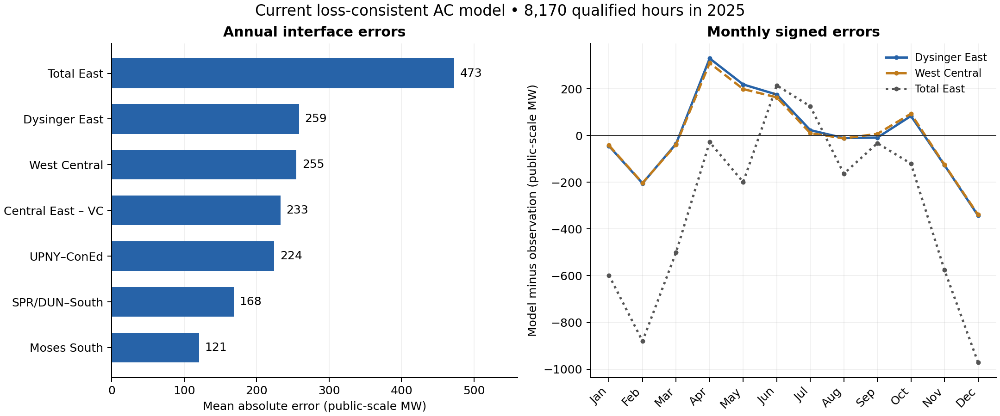
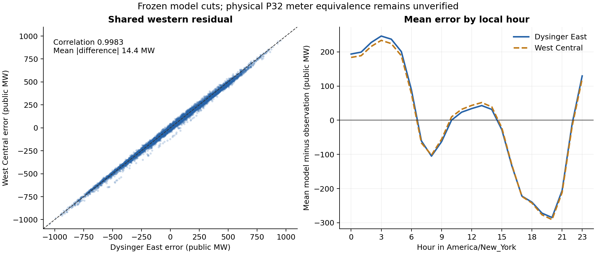

# Remaining interface-error diagnosis — current loss-consistent AC model

Investigated 2026-10-15 against numerical baseline `303b626bcab43215c839ad7e175e7274f25b4bdc`, branch `codex/s13-phase1b-upny-coned`.

The largest remaining discrepancies have different mechanisms. Dysinger East and West Central share an almost identical, seasonally and hourly varying residual. Total East has the largest absolute error and a substantial winter underprediction. Exact model-cut accounting sharply limits which network changes can affect each discrepancy. Separate controlled solves isolate an oversized zone-F loss mechanism without improving the interface flows. No replacement model or dispatch was promoted.

## Evidence and scope

The annual analysis uses the **same 8,170 equation/loss/recovery-qualified hours** from the current model: 8,651 source-qualified hours out of 8,760 clock hours; 481 source-qualified hours fail numerical/accounting gates and 109 lack source qualification. Failed iterates are excluded. These are saved 2025 model results freshly analyzed here, not new operating telemetry. None of the 8,170 hours passes all operating limits.

Public-interface values in `comparison_arrays.npz` are already public-scale MW. They are not divided by gamma again. Electrical losses and probe conservation checks use model MW; gamma is 0.30012075175285535. Positive residual means model minus observation. The primary comparison retains the frozen signed original-from-terminal convention.

Physical 2025 P32 meter/circuit membership remains incompletely established. The source header `Flow(MWH)` continues to use the pre-existing conditional numeric-as-MW interpretation. The cut identities below prove properties of this model; they do not certify equivalence to the physical meter gates.

## Annual ranking

| Interface | MAE, public MW | RMSE, public MW | Bias, public MW | WAPE |
|---|---:|---:|---:|---:|
| Total East | 472.69 | 580.48 | −326.00 | 14.70% |
| Dysinger East | 258.64 | 319.98 | +4.99 | 29.96% |
| West Central | 255.04 | 315.77 | +2.29 | 45.86% |
| Central East – VC | 233.06 | 284.96 | +172.43 | 13.70% |
| UPNY–ConEd | 224.33 | 283.15 | −15.79 | 7.56% |
| SPR/DUN–South | 168.42 | 214.37 | −62.40 | 9.18% |
| Moses South | 120.78 | 149.82 | +11.83 | 22.94% |

All seven annual metrics reproduce the sealed comparison exactly. West Central's larger percentage error partly reflects its smaller observed-flow denominator; its absolute discrepancy is almost the same as Dysinger East. Errors across overlapping cuts must not be summed as independent system error.

Evidence: [annual metrics](output/nygrid_2025_remaining_errors/baseline/annual_metrics.csv), [monthly metrics](output/nygrid_2025_remaining_errors/baseline/month_metrics.csv), [baseline receipt](output/nygrid_2025_remaining_errors/baseline/baseline_receipt.json).

## Western errors: shared net-injection mismatch, not an impedance-fitting opportunity

Dysinger and West Central residual correlation is **0.998256**. Their residual difference has only **14.39 MW MAE**, versus 258.64 and 255.04 MW individually. Their equal-weight common component accounts for **99.91% of joint centered variance**. Of each interface's 817 worst hours, 778 overlap.

The common residual changes sign: at 03:00 New York time, average Dysinger/West errors are about +246/+234 MW, while at 20:00 they are about −285/−291 MW. Monthly biases change from April +330/+310 MW to December −343/−339 MW. Annual mean bias near zero therefore conceals large timing/shape discrepancies. This is not a handful of extreme hours: the worst 1% contributes only about 3.3% of their total absolute error.

Under the declared half-endpoint ownership of internal NY line losses, a complete NY-zone cut obeys:

`midpoint export = native/HQ generation + external imports received within the cut + prescribed transfer injections − gross P58 demand`.

The frozen primary terminal sum adds the signed half-corridor-loss correction. Internal losses cancel from the complete-cut midpoint identity because gross P58 already includes the allocated loss. In this model, Dysinger is the complete zone-A cut and West Central the complete A+B cut. Their difference isolates zone B's net injection, with its small terminal correction. Zone B has no external tie.

The apparent A–PJM parent 71 ends at passive bus 140, which has no generation, load or DC transfer. It is not an independent bulk-import landing path; its NY-end import is approximately −0.00628 public MW. With fixed Ontario exchange and fixed PAR schedules, the western midpoint balances are effectively fixed by the input contract. The matched AC-versus-corrected-DC mean changes are only +0.141 MW (Dysinger) and −0.266 MW (West), and mean absolute changes are 0.570/0.938 MW.

This localizes the investigation to **hourly zonal source inputs and physical gate equivalence**. It does not prove that Niagara alone is wrong. Candidate source terms include plant dispatch allocation, zonal gross-load scope, boundary/PAR measurement conventions, and meter membership. Prior within-A/B load reallocation tests were also null for these complete DC cuts; repeating arbitrary internal-X fits is not justified.

### Niagara monthly-source check

On the exact current 8,170-hour cohort, the EIA full-calendar-month Niagara mean exceeds the current selected-hour model mean in every month, by **96.74–172.48 public MW**. The model dispatch's monthly mean differs from its frozen prior by only **0.28–2.63 MW**. Yet the residual-implied western input adjustment is negative in spring and positive in winter. A uniformly upward monthly correction therefore cannot account for the observed sign reversal.

This comparison assumes the selected hours represent the full monthly EIA energy mean; it is not hourly metered Niagara generation. The residual-implied adjustments are oracle diagnostics and must not become dispatch targets.

Saved, source-only **DC** counterfactuals were rescored on the same 8,170 hours. The EIA-shaped outside-A/B adjustment worsens Dysinger/West MAE by **4.31/4.38 MW**. The bounded legacy recipe improves them by only **3.50/5.71 MW**. These are saved DC responses, not newly validated annual AC alternatives.

Evidence: [pair structure](output/nygrid_2025_remaining_errors/baseline/pairwise_residual_structure.csv), [hour-of-day metrics](output/nygrid_2025_remaining_errors/baseline/local_hour_metrics.csv), [Niagara monthly comparison](output/nygrid_2025_remaining_errors/baseline/niagara_monthly_prior_oracle_comparison.csv), [matched saved DC tests](output/nygrid_2025_remaining_errors/baseline/niagara_saved_DC_counterfactuals_same8170_metrics.csv).

## Total East and Central East: imports and bypass allocation remain relevant

Total East is the complete A–E to F–K model cut. Its variable external landing term is predominantly the PJM import received in C through parents 79/82; ISO-NE lands in F/G and does not directly enter this upstream balance. Central East equals **Total East minus parent 224's original-from flow** in the frozen operator. A difference between observed Total East and Central East is only an implied aggregate under a gate-equivalence assumption, not measured parent-224 flow.

Total East's −326.00 MW mean residual includes a pre-existing corrected-DC bias of −228.48 MW. Moving to the current AC/loss model shifts its mean by another −97.53 MW. The latter decomposes into an approximately **−156.86 MW midpoint/import-partition change plus +59.33 MW signed terminal correction**. This is an exact model comparison, not proof of the historical physical cause. Central East's AC–DC mean change is +457.13 MW, reflecting the bypass/partition response as well as terminal accounting.

Total East's winter DJF mean residual is **−814.10 MW**, with MAE 814.42 MW. January and February already underpredict by approximately 598 and 880 MW, before the December Dover cutover. The winter discrepancy cannot be assigned uniquely to Dover.

The original PJM baseline-generation and loss-allocation weights already equal their capacity proportions. Replacing them with capacity proportions is a numerical no-op. A genuinely different, bounded transfer of **100 public MW from external proxy bus 130 to bus 134**, preserving regional generation totals and all other inputs, increases Total East by **18.66 MW** and Central East by **10.31 MW** on the 15 selected hours. Reversing it gives almost symmetric responses. Other cuts change by less than 0.064 MW in either direction. This confirms a relevant sensitivity, but supplies no evidence that this redistribution represents actual 2025 dispatch or corrects the annual winter deficit.

Evidence: [matched AC/DC comparison](output/nygrid_2025_remaining_errors/physics/current_AC_vs_corrected_DC_same_hours.csv), [season metrics](output/nygrid_2025_remaining_errors/baseline/season_metrics.csv), [PJM probe responses](output/nygrid_2025_remaining_errors/probes/pjm_partition_responses.csv), [PJM receipt](output/nygrid_2025_remaining_errors/probes/pjm_partition_receipt.json).

## Other interfaces and clock check

Moses South is the complete zone-D cut. Zone D has no active external AC tie; its midpoint is fixed by native generation, signed HQ injection, two Ontario PAR transfers and gross D load. Its current AC–DC primary difference is entirely its signed terminal correction (mean −10.53 MW). The residual therefore requires attention to those inputs and meter equivalence before internal topology tuning.

UPNY–ConEd's complete A–G midpoint includes all active regional AC landings. Under fixed regional NY-terminal totals and six prescribed transfers, its AC–DC primary difference is entirely the terminal correction (mean −0.03165 MW; mean absolute 0.455 MW). SPR/DUN–South retains a separate downstream partition and terminal-loss mechanism, and its MAE is smaller than the four leading errors.

An explicit same-state, fully-qualified **7,936-hour common triplet cohort** tests −1/0/+1-hour alignment. Zero shift has the lowest MAE for all seven interfaces. This rejects a simple uniform one-hour alignment repair; it does not certify physical meter scope or every source timestamp convention.

Evidence: [current gate terms](output/nygrid_2025_remaining_errors/accounting/current_gate_terms.csv), [lag diagnostics](output/nygrid_2025_remaining_errors/baseline/lag_diagnostics.csv).

## Physical validity is a separate unresolved issue

Parent 41 (Rotterdam–Albany) averages **77.90 model MW loss** over the qualified year and supplies **96.27% of zone F's assigned loss**. Its engineered R/X is 0.0598327463/0.2040452503 pu, versus imported 0.0018/0.0089. Parent 224 averages **39.14 model MW loss** and supplies **50.82% of zone E's assigned loss**. Together they account for 34.47% of total cohort AC losses. Parent 224 remains an uncertified network equivalent.

Across the 15 calendar-selected hours, restoring parent 41's imported R/X reduces its mean loss **92.87 → 2.34 model MW**, zone-F assigned loss **96.65 → 6.12 model MW**, and total NY loss **208.59 → 118.07 model MW**. All seven interface flows remain effectively unchanged. Restoring imported B as well gives the same active-flow/loss result to numerical precision. These are admittance-only probes: thermal/conductor metadata were not rebuilt and no DLR qualification or model promotion is claimed.

Every one of the 8,170 equation-qualified hours violates the 1.05 pu voltage upper bound somewhere. The strongest recurring location is synthetic interior bus **79503 on parent 195**, spanning **1.10018–1.12001 pu**. Parent-185 interiors also violate persistently. This directs the physical review toward the sectioned equivalents, charging/shunt assumptions and voltage/reactive controls. It does not establish a single corrected parameter value. Lower-voltage violations also occur in 395 hours. Improving an interface score would not remove these operating-qualification failures.

Evidence: [loss concentration](output/nygrid_2025_remaining_errors/physics/parent_loss_concentration.csv), [voltage locations](output/nygrid_2025_remaining_errors/physics/voltage_bound_concentration.csv), [physical probe responses](output/nygrid_2025_remaining_errors/probes/paired_physical_responses.csv), [physics review](output/nygrid_2025_remaining_errors/physics/physics_review.json).

## Controlled-probe qualification and priorities

The experiment design froze 15 hours selected by calendar proximity, covering all four topology states, before reading probe scores. The initial 150 cases yield **142 qualified cases**, six infeasible +100 MW St Lawrence requests, and two line-search failures in negative hydro shifts. Rejected cases remain unavailable; paired sample scores are not annual estimates. All 15 baseline cases reproduce all seven saved annual interface flows exactly. The 30 additional PJM partition cases all qualify, with regional-import closure below 4.4e−11 model MW. The tests do not establish operating feasibility.

The bounded hydro probes confirm mechanisms: +100 public MW at Niagara shifts Dysinger by about +99.93 MW; +100 MW at St Lawrence shifts Moses by about +100.97 MW on its nine feasible sampled hours. Donors are conventional hydro outside A/B/D, statewide hydro is conserved, and original finite unit bounds remain enforced. These are sensitivities, not evidence for a uniform dispatch adjustment.

The next model work should follow three distinct tracks:

1. **Western/northern/UPNY source and meter reconciliation:** obtain or independently constrain hourly zonal/plant injections and actual P32 membership/sign/measurement semantics. Compare required corrections with source uncertainty and energy/capability constraints; do not fit an oracle dispatch to the observations.
2. **Total/Central East boundary representation:** source-check the PJM equivalents, their spatial allocation and the E–G bypass. The controlled direction establishes sensitivity but neither its real magnitude nor an appropriate annual replacement.
3. **Physical repair:** evaluate a coherent parent-41 synthetic realization using the existing imported-R/X conductor candidates, including charging/thermal metadata, and investigate parent-185/195 overvoltage and reactive support. A subsequent annual replay is warranted only after a concrete, source-supported candidate exists; retain equation, loss, voltage/Q/S and source/meter gates separately.

The investigation is complete as a diagnosis and set of controlled mechanism checks. Attribution to actual historical assets/dispatch, a validated replacement model, and operating-qualified annual results remain unresolved.

Reproduction and artifact map: [diagnostic README](scripts/nygrid_2025_remaining_errors/README.md). Numerical inputs and unrelated map working changes are protected by [source guard](output/nygrid_2025_remaining_errors/source_guard.json). The diagnostic supplement is additive to the existing handoff; it does not replace its sealed model or map.
