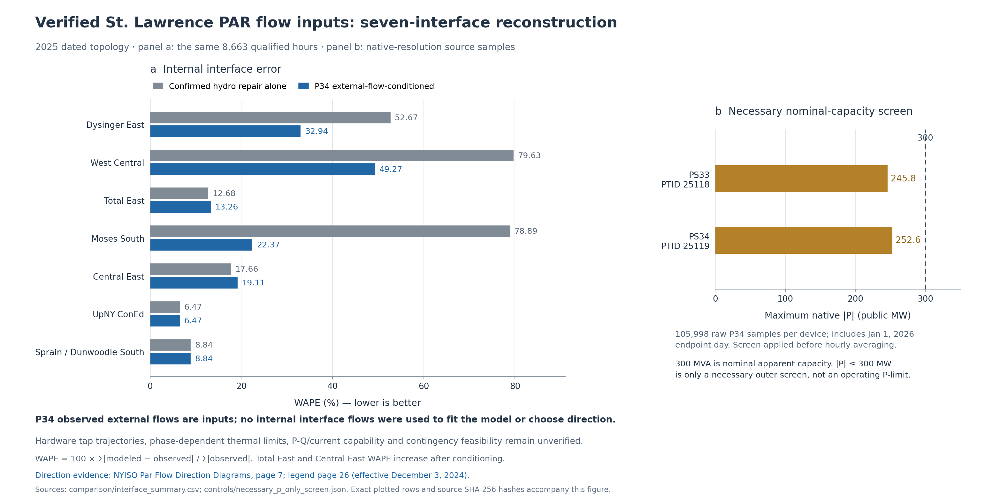

# St. Lawrence PAR direction, equipment evidence and controlled 2025 replay

The official NYISO diagram resolves the 2025 sign: **positive PS33/PTID 25118
and PS34/PTID 25119 flow is from St. Lawrence, Ontario, toward Moses, New York**.
The source's explicit effective date is **December 3, 2024**. The new DC case
uses the two measured external transfers separately, with per-device checks
against the necessary active-power envelope derived from the replacement
equipment's **300 MVA nominal rating**.

Moses South WAPE falls from **78.89% after the confirmed hydro-zone correction
to 22.37%**, and MAE from **425.82 to 120.76 public MW**, over the same 8,663
hours. This is a reconstruction conditioned on observed external PAR flows.
Internal interface observations are used only for the subsequent comparison.

**Complete physical operating limits remain unverified.** The source establishes
nominal equipment capacity and a **±60° no-load design range**, but not a full
P/Q, ambient, emergency, voltage, outage or tap-dependent operating envelope.
The case does not reconstruct physical tap positions or assert AC/thermal
feasibility. It implements the verified direction and the supported P-only
checks without inventing that missing information.

The preferred loader for this scope is
[npcc_nygrid_2025_par_controlled_dc.m](System%20Matpower%20Format/npcc_nygrid_2025_par_controlled_dc.m).
All earlier source files, cases, builders and audits remain preserved.

## Direction evidence that applies to 2025

NYISO's current **Par Flow Direction Diagrams** document was found through
ordinary navigation of its public website. Page 7 shows both positive arrows
pointing from St. Lawrence/IESO toward Moses/NYISO. Page 26 defines the arrow
legend. The red note on page 7 explicitly dates the convention to December 3,
2024, so the 2026 publication date is not being mistaken for a 2025 convention.
The document does not establish the earlier 2019 P34 sign retroactively.

- [Official NYISO PDF](https://www.nyiso.com/documents/20142/2268519/ParFlowDiagrams27.pdf/7bd78df8-311c-0b29-fa3f-ba0c8a51d123)
- [Saved official PDF](output/nygrid_2025_par_controls/sources/direction/NYISO_ParFlowDiagrams27.pdf)
- [Page 7: actual directional arrows](output/nygrid_2025_par_controls/sources/direction/NYISO_ParFlowDiagrams27_page07.png)
- [Page 26: legend](output/nygrid_2025_par_controls/sources/direction/NYISO_ParFlowDiagrams27_page26.png)
- [Verification receipt](output/nygrid_2025_par_controls/sources/direction/direction_verification_receipt.json)

No direction was selected from its Moses South error. The independently verified
direction happens to resolve the prior pair of diagnostic scenarios in favor
of the Ontario-to-Moses-positive interpretation.

## What the equipment sources establish

| Property | Verified evidence | Use in this case |
|---|---|---|
| Replacement PSR33/PSR34 nominal capacity | 300 MVA each; Hydro One CER application dated April 14, 2021, printed p4 of 13 | Necessary per-device `abs(P) <= 300 MW` screen only. Passing it does not prove `sqrt(P^2+Q^2) <= S` or an actual continuous operating limit. |
| L33P/L34P line continuous rating | 335 MVA each in the same application | Kept separate from the PAR equipment rating; not substituted as its limit. |
| New PAR design angle range | ±60° at no load; joint owner/manufacturer CIGRE 2021 paper and manufacturer publication, printed p44 | Hardware metadata only; not a constraint on a reduced-network equivalent phase offset. |
| Replacement completed before 2025 | Hydro One's 2024 status report, printed p41, confirms 2022–2023 completion | Establishes applicability of the replacement regime. |

The CER capacity paragraph and CIGRE technical pages were verified through
indexed text from the primary documents. Direct document downloads were
unavailable; no PDF bytes or hashes are claimed for those two sources.
The manufacturer publication and Hydro One completion report were downloaded,
hashed, and their relevant pages visually inspected.

Sources: [Hydro One CER replacement application](https://docs2.cer-rec.gc.ca/ll-eng/llisapi.dll/fetch/2000/90464/90548/424554/4084180/4087959/C12383-1_HONI_IPL_L33P_and_L34P_APP_04142021_-_A7S5U2.pdf?nodeid=4084177&vernum=-2),
[manufacturer publication](https://transformer-magazine.com/files/Advertorial-MR_VACUTAP-VRL.pdf),
[Hydro One 2024 status report](https://www.hydroone.com/abouthydroone/CorporateInformation/regionalplans/Documents/HONI_2024_Regional_Planning_Status_Report_20241101.pdf).
The [machine-readable limits](output/nygrid_2025_par_controls/sources/limits/limits.json)
and [qualification register](output/nygrid_2025_par_controls/sources/limits/qualification_register.csv)
record each claim, source, access limitation and missing quantity.

The full thermal/emergency curve, numerical as-built tap-to-phase table,
impedances, voltage/current dependence, control deadband and duty, hourly
equipment status and actual tap trajectory were not established. Historical
2011 ratings, the old NPCC `RATE_A`, and generic MATPOWER angle bounds are
explicitly excluded as evidence of the replacement equipment's 2025 limits.

## Control representation and preservation boundaries

Original NPCC branch 211 represents **48 (Moses E) → 100 (PHAS)**. Its aggregate
impedance and retained proxy terminals are not a verified model of the two
physical PARs. An imposed transfer previously required an equivalent phase
offset approaching 100°. It would be incorrect to interpret that offset as a
physical tap or to clip it to the hardware's ±60° no-load range.

The new representation therefore:

1. Keeps original branch 211, with its original endpoints and R/X/B/tap/SHIFT,
   but deactivates its passive AC contribution as an explicit **representation
   substitution**, not an asserted physical outage.
2. Adds two ideal, lossless controlled-transfer records from model bus 100 to
   48, retaining the separate PS33 and PS34 identities and signed measurements.
   These use MATPOWER's `dcline` container but are **not new physical HVDC links**.
3. Retains all 148 buses, the other AC branch records, the original four DC
   schedules, corrected generator terminals, all unit PG/bounds, P/Q demand,
   total external exchanges, and the seven fixed interface recovery operators.
4. Reports the logical original-branch transfer as `-(P33 + P34)`. The inactive
   passive record's AC PF is zero by construction and must not be interpreted
   as the physical cross-border transfer.

This is exactly equivalent, for lossless DC nodal balance and all other branch
flows, to imposing `f211 = -gamma*(P33_public + P34_public)`. It avoids exporting
an invented physical phase. The original source scalefactor
`gamma = 0.30012075175285535` is applied once; the necessary per-device model
envelope is **90.0362255 model MW**, corresponding to 300 public MW.

[Representation derivation and tests](output/nygrid_2025_par_controls/representation/implementation_choice.json)
and [independent representation audit](output/nygrid_2025_par_controls/representation/representation_audit.json).

## Source resolution, bounds and rejected inputs

All **211,996 retained native P34 readings** were independently checked against
the original archives before hourly aggregation, including the saved endpoint
day. The maximum absolute readings are **245.8 MW for PS33** and **252.6 MW for
PS34**. Neither device exceeds the necessary nominal-capacity P-only screen.
The script rejects individual violations even if opposite flows cancel in the
aggregate; it never clips a measured target to improve agreement.

The P34 source has 8,673 qualified physical hours; all **8,663 dispatch-qualified
hours** are covered. Original source gaps remain unavailable. Missing values
are not interpolated or copied between devices. Source hashes, PTID identity,
direction/effective date, metadata, limits and coverage must pass before a
case is solved.

The full 2025 P53A schedule source was also acquired and reconstructed, including
the 23-hour spring and 25-hour autumn days. Its 17,520 device-hour values are
preserved as separate raw schedule evidence. The interpretation of the P53A
`G/L` sign was not independently established, so those schedules are not
silently substituted for the verified observed P34 controls.

[Input receipt](output/nygrid_2025_par_controls/controls/input_receipt.json),
[hourly controls](output/nygrid_2025_par_controls/controls/hourly_controls.csv),
[native-resolution screen](output/nygrid_2025_par_controls/controls/necessary_p_only_screen.json),
and [independent source/gate tests](output/nygrid_2025_par_controls/validation/source_gate_validation.json).

## All seven interface comparisons

The dated-topology results below use the **same 8,663 hours**, with observations
read only after the controlled replay. WAPE is total absolute error divided by
total absolute observed flow. All MAE values are converted back to public MW.

| Interface | Hydro-repaired WAPE | With verified PAR flows | Hydro-repaired MAE, MW | With PAR flows MAE, MW |
|---|---:|---:|---:|---:|
| Dysinger East | 52.67% | **32.94%** | 441.90 | 276.39 |
| West Central | 79.63% | **49.27%** | 443.72 | 274.53 |
| Total East | 12.68% | 13.26% | 397.00 | 415.32 |
| Moses South | 78.89% | **22.37%** | 425.82 | 120.76 |
| Central East | 17.66% | 19.11% | 293.98 | 318.02 |
| UpNY–ConEd | 6.47% | 6.47% | 193.84 | 193.84 |
| Sprain/Dunwoodie South | 8.84% | 8.84% | 163.31 | 163.31 |

Moses signed bias falls from **+422.24 to +21.57 MW**. Western biases also
approach zero, but their substantial hourly absolute errors remain. Total East
and Central East worsen modestly. UpNY and Dunwoodie remain unchanged within
numerical precision. The fixed year-end variant is separately replayed;
its Dunwoodie WAPE remains 8.96%.

For context, the pre-hydro-correction Moses result was 95.36% WAPE and 514.77 MW
MAE. These source-backed improvements are not evidence that the entire network
or every physical flowgate is now accurate. In particular, the new results are
**conditioned on observed external PAR flows**, rather than predictions of PAR
operation from schedules, taps or an economic control model.

The existing aggregate regional exchanges still use the prior scheduled-series
reconstruction. The observed St. Lawrence split is imposed within those fixed
regional totals; this update does not certify every actual cross-border flow
or reconstruct all inadvertent and loop-flow components.

[Complete annual comparisons](output/nygrid_2025_par_controls/comparison/interface_summary.csv)
and [monthly comparisons](output/nygrid_2025_par_controls/comparison/interface_monthly.csv).



[PDF](output/nygrid_2025_par_controls/figures/verified_PAR_reconstruction.pdf)
and [SVG](output/nygrid_2025_par_controls/figures/verified_PAR_reconstruction.svg).

## Reproduction and validation

```matlab
addpath('System Matpower Format');
mpc = npcc_nygrid_2025_par_controlled_dc(1);
[result, success] = rundcpf(mpc, mpoption('verbose', 0, 'out.all', 0));
assert(success);
interfaces = npcc_nygrid_2025_slim_interfaces(result);
```

Pass `'year_end'` as the second argument for the fixed year-end case. The loader
rejects original and control-source gaps, wrong identities, inconsistent scale
or device envelopes, and out-of-envelope targets.

The two annual variants cover **17,326 qualified hour/topology states**.
Independent checks verify nodal and branch equations, full 191-bus recovery,
source controls, preserved generation/load/bounds and regional exchanges, and
all **42 annual and 504 monthly score rows**. The 21 source/target fixtures
include absent or altered provenance, reversed signs, invalid limits, hidden
native-resolution spikes, cancelling device violations, missing records and
both DST transitions. Independent MATLAB evidence is recorded separately.

All annual equation checks pass: maximum 148-bus nodal residual is 3.30e-11
model MW and recovered full-191 residual is 2.12e-10 model MW. The independently
recomputed scores match within 1.14e-13. **31 fresh MATPOWER snapshots** pass,
comprising 27 actual source snapshots and four explicit zero/counterflow
fixtures. Maximum interface disagreement is 2.23e-11 model MW and per-device
PAR transfer error is 7.11e-15 model MW. These confirm the stated DC equivalent
and loader behavior; they do not fill the missing physical operating envelope.

[Reproduction commands](scripts/nygrid_2025_par_controls/README.md),
[annual validation](output/nygrid_2025_par_controls/validation/independent_validation.json),
[MATPOWER validation](output/nygrid_2025_par_controls/validation/matlab_validation.json),
and [exact-byte delivery manifest](output/nygrid_2025_par_controls/delivery_manifest.json).

**Usable scope:** a source-directed, nominal-P-screened, external-flow-conditioned
2025 DC research reconstruction. Complete physical PAR tap/thermal/contingency
operation, AC feasibility, and certified 2025 physical flowgate membership
remain outside the established evidence.
