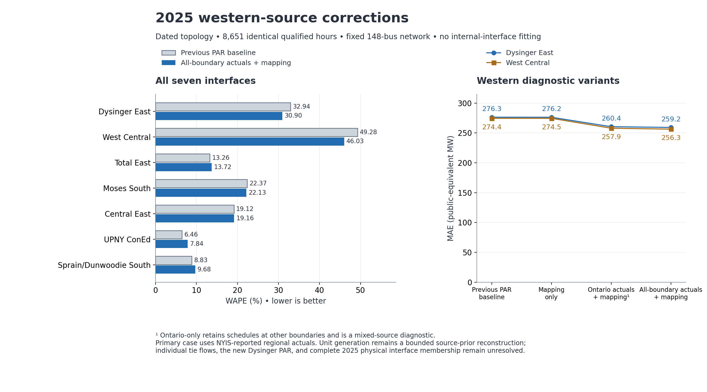

# 2025 western generation and interchange source audit

This version applies confirmed generator-location repairs and reconstructs dispatch using reported physical exchanges at all four New York boundaries. It preserves the 148-bus network and the verified external Moses PAR-flow controls. Internal interface observations are used only after reconstruction for scoring. The prior artifacts remain unchanged.

The usable result is a **source-conditioned DC reconstruction**, not observed hourly native-unit dispatch or a complete physical 2025 western network. The new Dysinger–East Stolle Road PAR circuit and exact 2025 physical interface membership remain unresolved. The complete source and validation record is in [the delivery manifest](output/nygrid_2025_western_audit/delivery_manifest.json).

Dysinger East MAE decreases from **276.3 to 259.2 MW**, and West Central from **274.4 to 256.3 MW**. Most of their shared error remains. Moses South improves slightly; Total East, Central East, UPNY ConEd and Sprain/Dunwoodie South worsen. The source choices and physical-input assumptions were fixed before these scores were computed.

## All seven comparisons

The table uses **8,651 identical qualified hours**, dated commissioning topology, and public-equivalent MW (model MW divided by the frozen scale factor). WAPE is `100 × sum(abs(prediction − observation)) / sum(abs(observation))`; it is not the mean of hourly percentage errors. Missing or quarantined hours are not filled.

| Interface | Baseline WAPE (%) | Corrected WAPE (%) | Baseline MAE (MW) | Corrected MAE (MW) |
|---|---:|---:|---:|---:|
| DYSINGER EAST | 32.942 | 30.903 | 276.268 | 259.172 |
| WEST CENTRAL | 49.281 | 46.028 | 274.448 | 256.328 |
| TOTAL EAST | 13.259 | 13.719 | 415.087 | 429.471 |
| MOSES SOUTH | 22.374 | 22.129 | 120.798 | 119.478 |
| CENTRAL EAST - VC | 19.120 | 19.160 | 318.113 | 318.782 |
| UPNY CONED | 6.458 | 7.842 | 193.637 | 235.141 |
| SPR/DUN-SOUTH | 8.834 | 9.676 | 163.238 | 178.807 |

[All annual variants, both cohorts and both topologies](output/nygrid_2025_western_audit/comparison/interface_summary.csv) · [all monthly comparisons](output/nygrid_2025_western_audit/comparison/interface_monthly.csv) · [scoring receipt](output/nygrid_2025_western_audit/comparison/scoring_receipt.json)



[Figure PDF](output/nygrid_2025_western_audit/figures/western_source_comparison.pdf) · [editable SVG](output/nygrid_2025_western_audit/figures/western_source_comparison.svg)

| Dated-topology variant | Dysinger East WAPE (%) | West Central WAPE (%) | Interpretation |
|---|---:|---:|---|
| `previous_PAR_baseline` | 32.942 | 49.281 | Previous frozen reconstruction |
| `mapping_only` | 32.933 | 49.283 | Confirmed locations only |
| `Ontario_actual_only` | 31.075 | 46.344 | Mixed boundary basis diagnostic |
| `Ontario_actual_and_mapping` | 31.050 | 46.311 | Mixed boundary basis plus locations |
| `all_boundary_actual_only` | 30.931 | 46.065 | All four NYIS actual regional exchanges |
| `combined` | 30.903 | 46.028 | Preferred source correction; all four exchanges plus locations |

The previous and mapping-only cases each retain 8,663 hours. The Ontario-only reconstruction has 8,657; the all-boundary reconstruction has 8,657. Their intersection defines the paired table. The CSVs also report each variant on its own qualified cohort. Year-end topology is a separate comparison, not pooled with dated topology.

## Why Dysinger East and West Central move together

The prior residuals have correlation **0.99835**; their common component accounts for **99.912%** of pairwise squared error. On this reduced network, direct nodal accounting establishes:

```
Dysinger East = zone A generation − zone A load + western Ontario net import
West Central − Dysinger East = zone B generation − zone B load
western Ontario net import = total Ontario import − measured northern PAR transfer
```

These identities hold to numerical precision. They explain why relocating a fixed injection within zone A cannot repair either total boundary flow, although it can change individual circuit loading. They do not identify a unique real-world cause of the residual. See the [hourly accounting audit](output/nygrid_2025_western_audit/balance/balance_validation.json).

The [post-hoc component check](output/nygrid_2025_western_audit/effects/effects_validation.json) decomposes the new western predictions exactly into Ontario boundary replacement, native-generation changes on the original map, location corrections at original generation, and their interaction. [Component statistics](output/nygrid_2025_western_audit/effects/western_component_summary.csv) report signed and absolute magnitudes; absolute magnitudes are not additive contributions to MAE reduction.

After correction, the western residual correlation remains **0.99824**, and their common component still accounts for **99.908%** of pairwise squared error. Ontario actual-versus-scheduled flow explains an important input difference but does not resolve the dominant remaining residual. The current evidence does not identify how much of that residual belongs to actual Niagara dispatch, omitted western controls, or the physical interface-operator mismatch.

## Confirmed mapping corrections

Eight site-specific zone corrections follow the 2025 Gold Book: Glenwood, Waterport, Mill Seat, Hyland LFGE, United States Gypsum, Synergy Biogas and Batavia GEN3 belong to zone B; High Acres belongs to zone C. Existing same-zone landing rules are reused only for unanchored proxy records. Valid Batavia GEN1/GEN2 controls and existing legacy electrical anchors are preserved. The aggregate bus62 is not relabeled wholesale: its physical station name and inherited accounting zone represent different levels of aggregation.

Lewiston Niagara's 12 inventory units move from the Huntley115 proxy to the existing Niagara230 project proxy; 11 admitted units participate in dispatch. This corrects a documented project/voltage mismatch. It is explicitly a coarse project landing, not a verified unit-to-terminal crosswalk. Together, the repairs change 40 inventory rows, including 28 zone changes and 39 bus moves; 36 admitted model rows change, with 35 bus moves. The earlier Moses-area hydro repairs are preserved.

The mapping-only case preserves every generator output, capacity, admission decision, load, prior and weight. See the [repair receipt](output/nygrid_2025_western_audit/corrected/repair_receipt.json), [site ledger](output/nygrid_2025_western_audit/mapping/source_confirmed_site_zone_proposals.csv), [unit ledger](output/nygrid_2025_western_audit/mapping/source_confirmed_unit_zone_proposals.csv), and [legacy-anchor proof](output/nygrid_2025_western_audit/corrected/immutable_site_legacy_crosswalk.json).

## Niagara generation allocation

The frozen plant-to-unit allocation and bounded projection reproduce to less than 1e-12 model MW, with no duplicate units. The official final 2025 EIA-923 release agrees with all **108** previously used Niagara/Lewiston/Gilboa monthly target quantities. No arithmetic or source-vintage generation-quantity defect was confirmed.

The baseline Robert Moses Niagara output averages 1,524.846 public MW across its 8,663 qualified hours, against a 1,523.185 MW mean prior on the same hours. Its full-year EIA energy is 14,318,419 MWh, or 1,634.523 MW over 8,760 hours. These have different hour scopes, and the current prior is a soft statewide-hydro projection rather than a hard plant-month energy constraint. The asymmetric curtailment/headroom rule can move the result away from plant-month energy. This is a model assumption requiring a separate operating-input redesign, not evidence permitting an arbitrary increase to Niagara dispatch.

NYISO documents six main units at Niagara230, four at Niagara115 East and three at Niagara115 West, with all twelve Lewiston units at Niagara230. The public evidence used here does not provide the unit-ID crosswalk and hourly three-terminal dispatch needed to replace the existing aggregate main-plant landing. The 2025 summer study's 50/50 split and 2,100 MW output are study assumptions, not a measured hourly series.

Lewiston's final EIA gross generation is 457,977 MWh, pumping consumption 702,696 MWh, and net generation −244,719 MWh. Gross generation, pumping and net generation cannot be substituted for one another. The hourly P63 hydro and load/pumping boundary have not been reconciled sufficiently to impose a new hourly storage trajectory or monthly energy constraint. No commercial entitlement multiplier, inferred hydrology-to-MW conversion, or interface-error correction is applied.

[Generation audit](output/nygrid_2025_western_audit/generation/generation_audit.json) · [monthly prior/dispatch audit](output/nygrid_2025_western_audit/generation/Niagara_Gilboa_monthly_prior_dispatch.csv) · [final-release comparison](output/nygrid_2025_western_audit/generation/EIA923_target_vintage_comparison.csv) · [source interpretation and limitations](output/nygrid_2025_western_audit/generation/source_interpretation.json)

## External interchange correction and qualification

The Ontario-only diagnostic replaces the NYISO Ontario schedule with IESO's reported aggregate actual exchange. The source uses fixed EST hour-ending labels throughout the year; positive flow means Ontario export to New York. Six all-intertie-zero IESO records with nonzero schedules are quarantined as suspect reports, without rewriting reported values. Single-region zero values remain eligible. The source's original annual CSV and separate quality mask are both retained.

The preferred reconstruction uses **NYIS-reported EIA-930 bilateral physical exchanges for Ontario, New England, PJM and Hydro-Québec together**. NYIS export-positive values are negated to import-positive values; UTC hour-ending timestamps are shifted back one hour to the frozen UTC hour-start axis. Published bulk columns state MW explicitly; the corresponding one-hour API MWh values are numerically identical. All 35,040 region-hour values are present, and all 25,000 cached API records agree exactly with the official bulk CSVs. The source vintage was retrieved on 2026-10-11; it is a historical-year reconstruction, not a live operating feed.

The independent source review distinguishes source-wide frozen reports from disagreements in a separate total-interchange field. Read the [source receipt](output/nygrid_2025_western_audit/boundary_actuals/source_audit_receipt.json) and its quality flags for the exact accepted cohort and exclusions. Bilateral totals are not forced to match a zero or inconsistent reported total. All exclusions are based on external-source evidence before interface scoring. Original data remain unchanged; no clipping, imputation, or internal-flow-based selection is used.

Independent Ontario and New England counterparty reports broadly agree with the NYIS perspective (MAE 4.018 MW and 7.204 MW on their stated qualified overlaps). The opposite PJM reporter differs substantially (MAE 594.856 MW across 8,631 available hours), with unresolved reporting-boundary conventions. That discrepancy is retained explicitly and does not drive a magnitude filter or source substitution. The chosen NYIS perspective is consistent across the four boundaries, but the all-boundary case must remain qualified by this reporting-scope uncertainty. Adjacent transition hours around the May6 frozen reports also retain unresolved discrepancies. [Independent source review](output/nygrid_2025_western_audit/boundary_source_review/independent_boundary_review.json)

For each region, the change from scheduled to actual aggregate import is applied using the frozen external-generator shares. Native generation is then reprojected with the **same** original source priors, weights and capacity bounds to meet the corrected net balance. Ontario-only changes can be offset by other boundaries, so the Ontario-only diagnostic is not the preferred physical-input correction. This construction does not make the recovered individual native-unit outputs observed dispatch.

The four original DC-device schedules and measured northern PAR transfers remain fixed. Therefore regional actual totals are corrected, while the within-region AC/DC partition and individual Niagara tie flows remain conditional. External aggregate flow is valid conditioning information, but it reduces the independence of a predictive comparison and must be disclosed.

[All-boundary reconstruction receipt](output/nygrid_2025_western_audit/dispatch/all_boundary_dispatch_receipt.json) · [Ontario-only receipt](output/nygrid_2025_western_audit/dispatch/dispatch_receipt.json) · [regional actuals versus schedules](output/nygrid_2025_western_audit/boundary_actuals/external_schedule_actual_comparison.csv)

## Remaining western network limitations

The 2025 operating study includes a Dysinger–East Stolle Road345 PAR schedule of 400 MW. The frozen western network omits that new circuit. A PERFORM planning workbook provides a 2030 line row, but it does not establish the 2025 PAR hardware, terminal crosswalk, control sign, ratings, tap limits or complete metered interface membership. Adding it to bus62 based only on a similar station name would conflate voltage levels and accounting zones. It is documented as a confirmed model gap and is not fabricated or fitted here.

The P32 channel, UTC aggregation, seven-interface operators, and 148-/191-bus recovery were audited in 1,246 checks without a confirmed operator or channel implementation defect. This validates the declared reduced-model operator; it does not certify equivalence to all physical 2025 interface meters. See the [mapping/operator audit](output/nygrid_2025_western_audit/mapping/mapping_summary.json) and [physical-source scope](output/nygrid_2025_western_audit/mapping/physical_source_scope.json).

## Reproduce and use

From `C:\Users\Holiday\Desktop\npcc_ny_lite_package_fixed\WECC and NPCC Systems`, the preserved audit and build scripts are under `scripts/nygrid_2025_western_audit`. Source preparation and construction never use scored internal interface columns as targets. Scoring is an explicit later step in `replay_western.py`.

```powershell
python scripts/nygrid_2025_western_audit/reconstruct_dispatch.py
python scripts/nygrid_2025_western_audit/reconstruct_all_boundaries.py
python scripts/nygrid_2025_western_audit/replay_western.py
python scripts/nygrid_2025_western_audit/validate_western.py
```

With configured MATPOWER in MATLAB:

```matlab
addpath('System Matpower Format');
mpc = npcc_nygrid_2025_western_corrected_dc(1, 'dated', 'combined');
results = rundcpf(mpc, mpoption('verbose', 0, 'out.all', 0));
flows = npcc_nygrid_2025_slim_interfaces(results);
```

The [new loader](<System Matpower Format/npcc_nygrid_2025_western_corrected_dc.m>) accepts `dated` or `year_end`, and any non-baseline mode listed above. Invalid or unqualified hours are rejected; another hour is never silently substituted. The earlier PAR loader remains available for the frozen baseline.

Fresh MATLAB validation solved **95** snapshots spanning all five new modes, both topologies, seasonal conditions, commissioning states, fall DST hours and native-generation extremes. Maximum branch disagreement is 1.54e-11 model MW and maximum interface disagreement is 2.67e-11 model MW. It also checks native capacity bounds, generator locations, unchanged loads and six transfer targets, plus rejection of missing sources and all six suspect IESO hours. [MATLAB receipt](output/nygrid_2025_western_audit/validation/matlab_validation.json)

Independent validation checked all qualified hours in **12 annual replays**, reconstructed the 191-bus parent equations, and recomputed all **168 annual and 2016 monthly score rows** without importing the production solver, controller or scorer. Maximum recovered full-network KCL error is 2.22e-10 model MW. [Independent validation](output/nygrid_2025_western_audit/validation/independent_validation.json)

The source and dispatch guard suites passed **52 Ontario tests plus 27 all-boundary tests**. [Ontario guard receipt](output/nygrid_2025_western_audit/validation/source_gate_review.json) · [all-boundary guard receipt](output/nygrid_2025_western_audit/dispatch/all_boundary_guard_test_receipt.json). To verify the delivered source/output hashes without repeating numerical work, run `python scripts/nygrid_2025_western_audit/finalize_western.py --verify`. Deliberately rebuilding outputs requires rerunning their dependent checks and regenerating the manifest; changed artifacts must not be treated as the sealed delivery.

AC/reactive feasibility, unit commitment, ramps, storage energy balance, branch thermal limits and actual PAR tap trajectories remain unverified. Correcting source inputs does not remove those model limitations.
